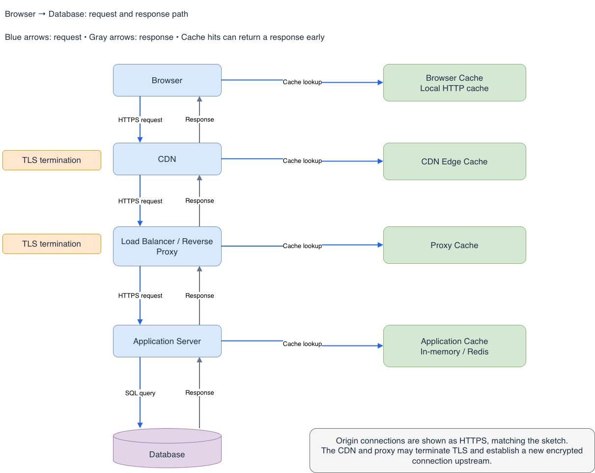

# Browser → database → browser

Illustrative architecture: components may be combined, omitted or reordered. Arrows represent application exchanges, not one continuous TCP connection. A normal response returns through the intermediaries that forwarded that request.

## Original diagrams

These PNGs are unchanged copies of the diagrams in the combined Day 1–2 folder.




[Handwritten notes — original Note.pdf](Note.pdf)

The text below supplements the original images with explicit request/response, TLS and cache annotations.


## Plain-text version

```text
DNS (before connecting, unless answer or connection already available):
Browser/OS → recursive resolver → root → TLD → authoritative DNS
           ← cached or newly resolved IP address ←
The resolver follows referrals; DNS servers do not forward the HTTP request.

REQUEST ↓                                      RESPONSE ↑
Browser [HTTP cache: a fresh hit can stop here]
  ⇅ HTTPS: TCP+TLS (HTTP/1.1 or HTTP/2), or QUIC (HTTP/3)
Local router / NAT → ISP → Internet
  ⇅ encrypted traffic
CDN / WAF [T1: TLS terminates; HTTP edge cache]
  ⇅ separate HTTPS connection on edge miss
L4 load balancer [TCP pass-through; no TLS termination here]
  ⇅ still encrypted; same origin-side TLS connection
L7 reverse proxy [T2: TLS terminates; optional HTTP cache]
  ⇅ separate HTTPS connection
API gateway [T3: TLS terminates; optional HTTP cache]
  ⇅ separate HTTPS connection
Application server [T4: TLS terminates]
  ⇄ Application data cache [hit avoids a database query]
  ⇅ on data-cache miss: database protocol over its own TLS connection
Database [T5: DB TLS endpoint; buffer pool caches data pages]
```

## TLS and cache boundaries

- T1–T4 are HTTP TLS endpoints in this example; each endpoint decrypts incoming traffic and opens/reuses a separate upstream connection. T5 protects the database protocol, not HTTP. Verify certificates on each encrypted hop. A router/NAT ordinarily forwards encrypted traffic without decrypting it.
- The example L4 balancer passes TCP traffic through. A TLS-capable L4 product could terminate TLS in another design. If the CDN accepts HTTP/3, it may use HTTP/2 or HTTP/1.1 over TCP to reach this origin; protocol versions need not match across hops.
- A browser hit avoids the network; CDN/proxy/gateway hits can return early along the already-traversed path. Store only eligible responses under correct cache keys and privacy rules. WAF filtering and caching order depends on configuration.
- An application cache stores data or computed results and may help build a response. A database buffer pool stores internal pages. Neither is automatically an HTTP response cache. DNS caches store name-resolution answers, not page content.
- On an origin miss, the database result goes to the app, which constructs the HTTP response. Intermediaries forward it back, optionally storing eligible responses. The browser decrypts, processes headers/cookies and renders the body.
- Internal HTTP instead of HTTPS is a possible deployment choice, but then that hop is unencrypted. TLS can also terminate directly at the application if edge/proxy devices pass it through.
