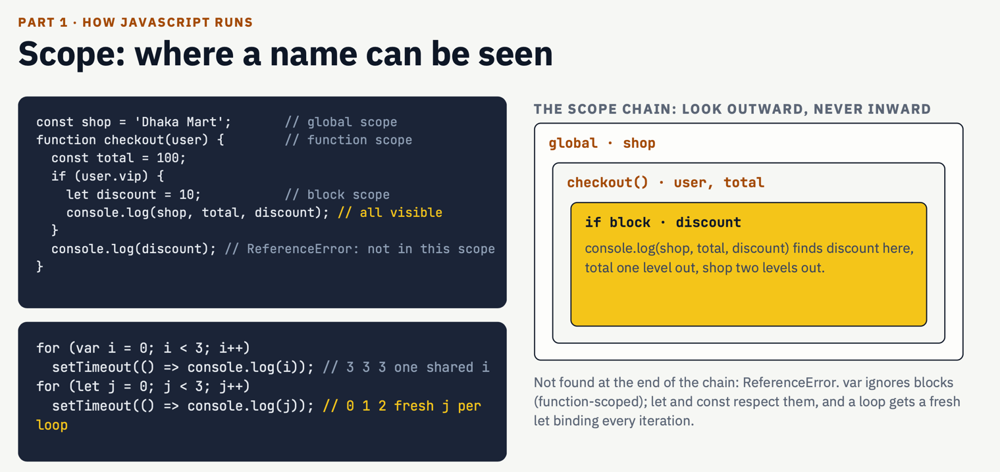
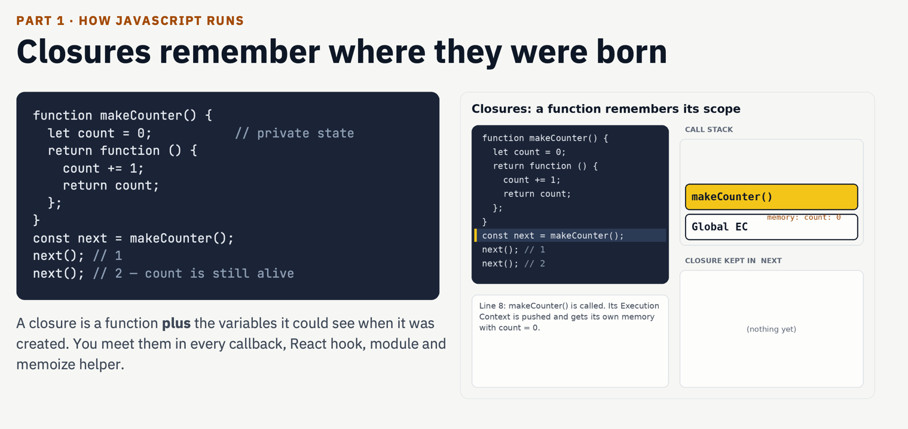
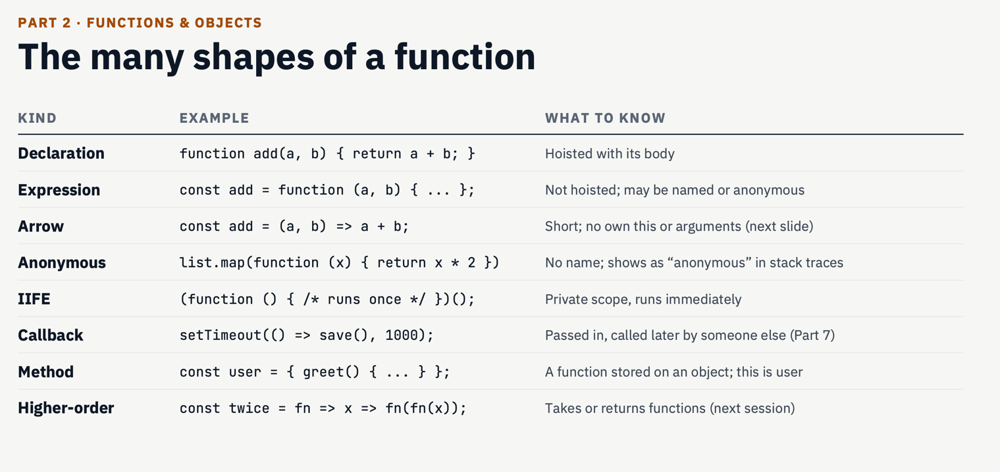
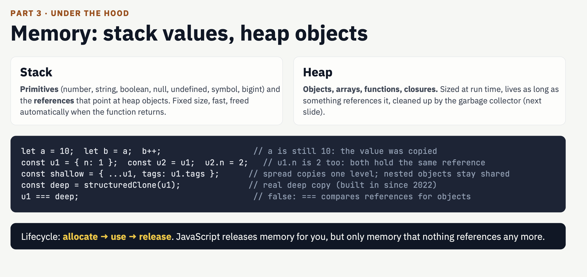
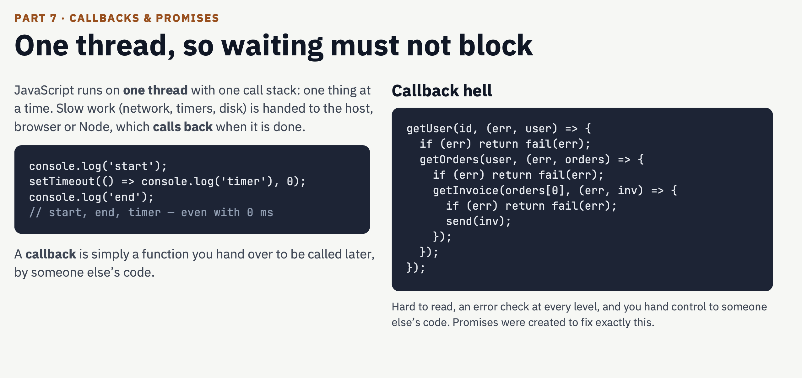
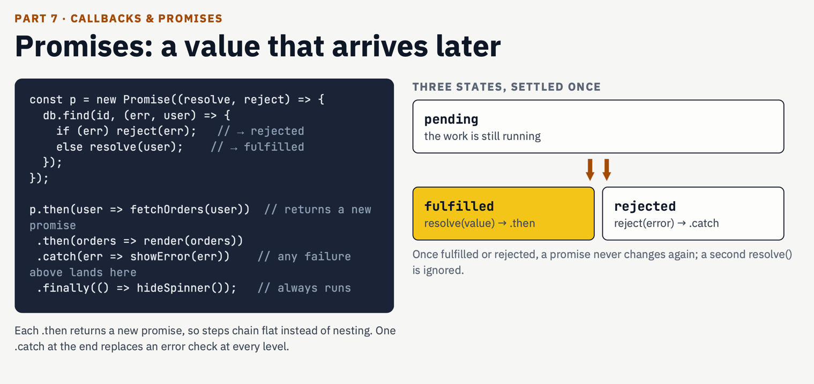
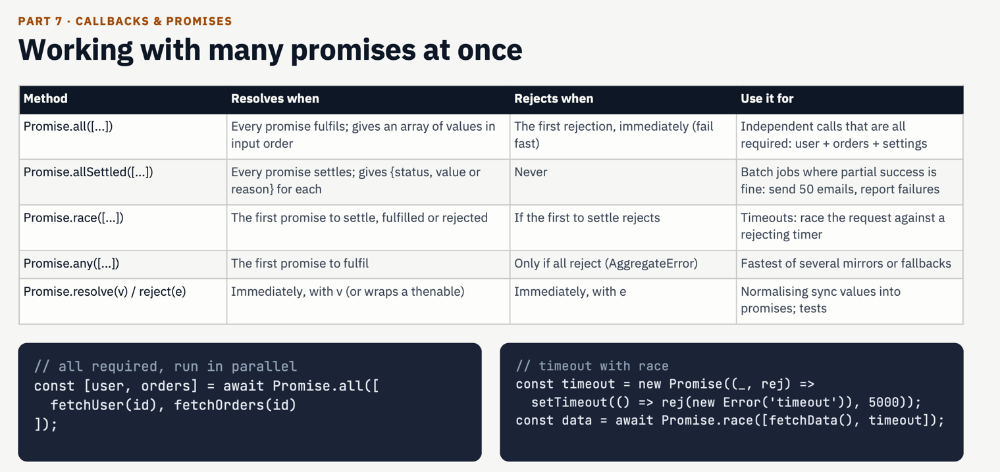
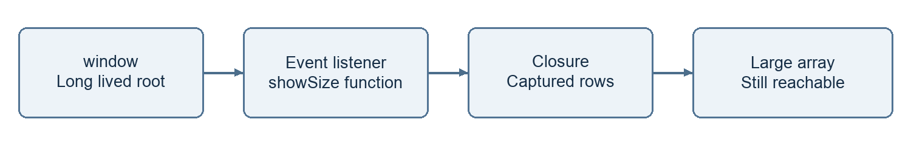

# Day 3 JavaScript in Depth

## What I want to understand

I want to understand what happens when my JavaScript code runs. These notes cover scope, functions, objects, async code, memory and engine behaviour. I also explain the order of mixed promises and timers, and how a closure can keep unwanted memory alive.

I use small examples so I can follow each step. Each code block is a separate example unless I give file names. I use a browser for the event loop examples. Node.js has extra scheduling rules.

### My reading order

1. I start with variables, scope, functions and objects.
2. I learn how values, modules and the call stack work.
3. I follow promises, timers and the event loop.
4. I study memory, metaprogramming and engine behaviour.
5. I use these ideas to explain the two research tasks.

I keep the browser rendering notes in Day 2. Here I focus on JavaScript and the two Day 3 research questions.

## Variables scope and hoisting

I use <mark>const</mark> when I <mark>do not need to assign a new value</mark>. I use <mark>let</mark> when <mark>the value must change</mark>. I usually avoid var in new code.

Scope means where I can use a name. A function creates function scope. A block is a section inside curly braces. let and const stay inside their block. var belongs to its function or global scope.

```javascript
if (true) {
  var city = "Dhaka"
  let score = 10
  const user = { name: "Mina" }
  user.name = "Rima"
}
console.log(city) // Dhaka
// console.log(score) would throw ReferenceError
```

const stops reassignment. It does not freeze an object. I can change user.name inside the block.

### What happens before a declaration runs

**I understand hoisting as the setup of variable and function bindings before JavaScript executes the code. My source code does not move. A var binding starts with undefined.**

```javascript
console.log(age); // undefined
var age = 25;
console.log(age); // 25
```

The binding exists before the declaration runs, but I assign 25 only when execution reaches var age = 25.

**let and const are hoisted, but I cannot access them before their declarations run.**

```javascript
console.log(score); // ReferenceError
let score = 10;
```

The Temporal Dead Zone (TDZ) lasts from the start of the scope until the declaration initialises the binding.

**I can call a function declaration before execution reaches its declaration.**

```javascript
greet(); // Hello

function greet() {
  console.log("Hello");
}
```

**My reminder: var starts as undefined; let and const throw before initialisation; a function declaration can be called earlier.**

### Why I avoid var

1. var ignores block scope. A variable declared inside an if or for block is still accessible outside it, which can cause mistakes.

```javascript
if (true) {
  var age = 25;
}
console.log(age); // 25
```

With let or const, reading age outside this block would throw ReferenceError.

2. var allows redeclaration in the same scope. An accidental second declaration with an initialiser can overwrite the earlier value.

```javascript
var age = 25;
var age = 30; // Allowed: previous value changes
```

With let or const, declaring the same name again in the same scope would cause SyntaxError.

3. var can hide use-before-declaration mistakes by giving undefined instead of throwing an error.

```javascript
console.log(score); // undefined
var score = 10;
```

With let or const, reading the variable before its declaration runs would throw ReferenceError, making the mistake easier to find.



## Functions and closures

I use a function to group work. A parameter receives an input. return sends a value back. A function without an explicit return gives undefined.

```javascript
function add(a, b) {
  return a + b
}
console.log(add(2, 3)) // 5
const double = n => n * 2
console.log(double(4)) // 8
```

A function declaration can be called before its declaration runs. An arrow or function expression follows the rules of its variable. A const function cannot be called before initialisation.



### How I understand a closure

A closure lets a function keep access to outer variables. The outer function can finish. The returned function can still use those variables. It keeps access to the binding, not a frozen copy.

```javascript
function makeCounter() {
  let count = 0
  return function () {
    count += 1
    return count
  }
}
const next = makeCounter()
console.log(next()) // 1
console.log(next()) // 2
```

1. I call makeCounter. It creates count with the value 0.
2. The inner function is returned and stored in next.
3. The outer call ends. next still has access to count.
4. Each call to next updates the same count binding.

I can use a closure for private state. Each new call to makeCounter creates a separate count binding.



### I keep separate account balances with closures

I use this example to see how a returned function remembers and updates an outer variable after the outer call has finished.

```javascript
function createaccount(initbalance) {
  let balance = initbalance;

  return function getBalance(account) {
    balance += account;
    console.log(`Your balance is ${balance}`);
  };
}

const myAccount = createaccount(100);
myAccount(50); // Your balance is 150
myAccount(25); // Your balance is 175

let myAccount2 = createaccount(200);
myAccount2(100); // Your balance is 300
myAccount2(50);  // Your balance is 350
```

1. I call createaccount(100). This call creates its own balance binding and initialises it to 100. I return the getBalance function itself; I do not call it yet.

2. I store that function in myAccount. Although createaccount has finished, the returned function keeps access to this call’s balance. That retained access is the closure.

3. myAccount(50) gives account the value 50 and updates balance from 100 to 150. myAccount(25) uses the same binding, so it updates 150 to 175. The balance does not reset on each inner call.

4. createaccount(200) is a new outer call with a separate balance binding. I store its returned function in myAccount2. Its calls change that balance from 200 to 300 and then 350, without changing myAccount’s balance of 175.

The variable names myAccount and myAccount2 hold functions, not account objects. Both returned functions use the same code, but each has access to its own outer call’s state. I cannot access either balance directly by its local name from outside.

I write return function getBalance(account) { ... } because returning a function expression requires the function keyword here. In this example account is the amount I add, so amount would be a clearer parameter name. Despite its name, getBalance adds money and prints the new balance; it does not merely read or return the balance.

### Different ways I use functions

These examples run separately. A declaration, an expression and an arrow are different ways to define a function. A callback describes how a function is used; it can use any of these forms.

### Function declaration

I give the function a name and call it when needed. A function declaration is initialised before execution reaches its line, so this call works.

```javascript
console.log(add(2, 3)); // 5
function add(a, b) {
  return a + b;
}
```

### Function expression

I store a function value in a variable. Here subtract is a const binding, so I call it only after its initialisation.

```javascript
const subtract = function (a, b) {
  return a - b;
};
console.log(subtract(8, 3)); // 5
```

### Arrow function

An arrow gives me a shorter syntax. With one expression, it returns that expression automatically. With braces, I write return explicitly. Its this behaviour is explained below.

```javascript
const double = n => n * 2;
const multiply = (a, b) => {
  return a * b;
};
console.log(double(4)); // 8
console.log(multiply(3, 4)); // 12
```

### Callback function

I pass a function to another function as an argument. Here map calls the callback once for each array element. A callback does not automatically mean asynchronous code.

```javascript
const numbers = [1, 2, 3];
const doubled = numbers.map(n => n * 2);
console.log(doubled); // [2, 4, 6]
```

### Object method

A method is a function stored as an object property. Calling user.greet() gives this regular method user as its this value.

```javascript
const user = {
  name: "Mina",
  greet() {
    return "Hello " + this.name;
  }
};
console.log(user.greet()); // Hello Mina
```

## Arrow functions and this

In these examples, this identifies the object whose data I use. For a regular function, I check the call. An arrow has no own this; it takes this from the surrounding scope where I create it.

### How a regular method gets this

```javascript
"use strict";
const user = {
  name: "Mina",
  greet() {
    return this.name;
  }
};
console.log(user.greet()); // Mina
```

I call user.greet(), so user is the receiver before the dot. For this call, this is user and this.name reads user.name, which is "Mina". The function is not permanently bound to user.

### What happens when I copy a method

```javascript
const greet = user.greet;
// Run this with the strict-mode example above.
// greet(); // TypeError: this is undefined
```

With const greet = user.greet, I copy the function value. Calling greet() is a plain call without a receiver. In strict mode, this is undefined, so reading this.name throws TypeError. A non-strict ordinary function uses globalThis for a plain call; that still does not make this equal to user. The following greet examples continue the strict-mode example above.

### Choosing this with call and apply

```javascript
console.log(greet.call({ name: "Rima" })); // Rima

function introduce(prefix, suffix) {
  return prefix + this.name + suffix;
}
console.log(introduce.call(user, "Hi ", "!")); // Hi Mina!
console.log(introduce.apply(user, ["Hi ", "!"])); // Hi Mina!
```

I use call or apply to run a function immediately with a chosen this value. In greet.call({ name: "Rima" }), the supplied object becomes this, so I get "Rima". I pass additional arguments individually with call and in an array or array-like object with apply.

### Keeping this with bind

```javascript
const fixed = greet.bind(user);
console.log(fixed()); // Mina
```

When I use bind(user), greet does not run immediately. I receive a new function. Calling fixed() later uses user as this even without user before the call. The original greet function is unchanged.

### An arrow takes this from outside

```javascript
const counter = {
  value: 0,
  schedule() {
    setTimeout(() => {
      this.value += 1;
      console.log(this.value); // 1
    }, 0);
  }
};
counter.schedule();
```

1. I call counter.schedule(), so the regular method schedule receives counter as this.
2. schedule creates the arrow callback. The arrow has no own this, so it uses the surrounding schedule call's this.
3. When the timer runs the arrow later, this still refers to counter. this.value += 1 changes counter.value from 0 to 1, and the console shows 1.

The timer does not choose this for my arrow. A regular timer callback would receive this according to the timer environment instead of inheriting schedule's this. I can use an arrow or a bound function to keep counter.

### Why I avoid an arrow for this kind of method

```javascript
const user = {
  name: "Mina",
  greet: () => {
    return this.name;
  }
};
// user.greet() does not make this equal to user.
```

An object literal does not create a new this binding. Writing this arrow inside user does not make its this equal to user. It takes this from the outer scope. At the top level of an ES module, this is undefined, so this.name throws TypeError. Other outer contexts can produce a different result. When I need the receiver object, I use greet() { return this.name; }.

### Other arrow function rules

An arrow has no own arguments object. I use rest parameters such as ...numbers to collect arguments. call, apply and bind cannot replace its lexical this. An arrow is not a constructor, so calling it with new throws TypeError.

```javascript
const sum = (...numbers) => {
  return numbers.reduce((total, n) => total + n, 0);
};
console.log(sum(1, 2, 3)); // 6
```

In an ordinary constructor call such as new Person("Mina"), this normally refers to the new instance. My rule: for a regular function I check the call; for an arrow I check the surrounding this.

## Objects prototypes and classes

I use objects to store data and functions. A prototype lets an object use properties from another object. A class gives me a convenient way to create objects with a common structure.

### What an object contains

An object contains properties. When a property's value is a function, I call it a method. Below, name is a data property and speak is a method.

```javascript
const dog = {
  name: "Rex",
  speak() {
    return this.name + " makes a sound";
  }
};
console.log(dog.name); // Rex
console.log(dog.speak()); // Rex makes a sound
```

### How prototype lookup works

I run this example separately. speak belongs to animal. Object.create(animal) creates a new dog object with animal as its prototype. It does not copy animal's properties.

```javascript
const animal = {
  speak() {
    return this.name + " makes a sound";
  }
};
const dog = Object.create(animal);
dog.name = "Rex";
console.log(dog.speak()); // Rex makes a sound
```

1. When I call dog.speak(), JavaScript first looks for speak on dog itself. It is not there.
2. JavaScript looks on dog's prototype, animal, and finds speak.
3. I called the method as dog.speak(), so this is dog. Where the method was found does not determine this for this call.
4. this.name reads dog.name, which is "Rex". The result is "Rex makes a sound".

### Own and inherited properties

```javascript
console.log(Object.hasOwn(dog, "name")); // true
console.log(Object.hasOwn(dog, "speak")); // false
```

I use Object.hasOwn to check only an object's own properties. name belongs directly to dog. speak is available through animal, so Object.hasOwn(dog, "speak") is false.


I read the prototype chain from left to right as JavaScript looks for a property.

```text
dog → animal → Object.prototype → null
```

If an ordinary property read finds nothing along this chain, I get undefined. Obtaining properties through a prototype is prototype inheritance.

```javascript
console.log(dog.age); // undefined
```

### Creating objects with a class

I use a class to create objects with a common structure. An object created with new is an instance of that class.

```javascript
class Person {
  constructor(name) {
    this.name = name;
  }
  greet() {
    return "Hello " + this.name;
  }
}
const person = new Person("Mina");
console.log(person.name); // Mina
console.log(person.greet()); // Hello Mina
```

1. new Person("Mina") creates an instance. The constructor sets its initial data.
2. Inside this constructor, this refers to the new instance. this.name = name stores "Mina" in its name property.
3. greet is on Person.prototype. Instances can share that method rather than each receiving a separate greet function.

```javascript
console.log(Object.hasOwn(person, "name")); // true
console.log(Object.hasOwn(person, "greet")); // false
```

### How extends and super work

I run the next example after the Person class. extends Person makes Intern inherit from Person. Writing my own version of an inherited method is method overriding.

```javascript
class Intern extends Person {
  greet() {
    return super.greet() + " from an intern";
// I use super to call the parent constructor or a parent method from a child class.

  }
}
const intern = new Intern("Mina");
console.log(intern.greet());
// Hello Mina from an intern
```

1. I have not written an Intern constructor. Its default constructor forwards "Mina" to Person's constructor, which sets name on the new intern object.
2. intern.greet() finds the method on Intern.prototype. This method overrides Person's greet.
3. super.greet() runs Person's greet with the same intern object as this. It returns "Hello Mina".
4. I append " from an intern", giving "Hello Mina from an intern".

```text
intern → Intern.prototype → Person.prototype
       → Object.prototype → null
```

I remember the relationship this way: objects hold properties, prototype chains provide lookup, and classes give me convenient syntax over that system. Classes also have their own rules, including strict-mode class bodies and private fields.

## Values coercion and equality

A primitive is a basic JavaScript value. Immutable means that I cannot change the value itself in place.

### What a primitive is

JavaScript has seven primitive types. Objects, arrays and functions are not primitive values; arrays and functions are objects too.

```javascript
string     // "Mina"
number     // 10, 3.5
boolean    // true, false
undefined  // undefined
null       // null
bigint     // 123n
symbol     // Symbol("id")
```

I commonly get undefined from a variable that has not been assigned a value. I use null to represent an intentional absence of a value.

### What immutable means

Once a primitive value exists, I cannot modify it in place. I use a string character assignment to see the difference between changing a value and assigning a new one.

```javascript
let name = "Mina";
name[0] = "R";
console.log(name); // "Mina" in non-strict mode
```

### Changing a value and reassigning a variable

```javascript
let name = "Mina";
name = "Rima";
console.log(name); // Rima
let age = 20;
age = age + 1;
console.log(age); // 21
```

### What happens when I assign a primitive

```javascript
let a = 10;
let b = a;
b = 20;
console.log(a); // 10
console.log(b); // 20
```

With b = a, I copy a's value into b. Assigning a new value to b does not change a. They are separate variable bindings.

### What mutable means for an object

I can change the properties of an ordinary object, so it is mutable. Object assignment still copies a value, but that value is an object reference. It does not create another object.

```javascript
const first = { score: 1 };
const second = first;
second.score = 2;
console.log(first.score); // 2
console.log(second.score); // 2
```

first and second refer to the same object. When I change score through second, I see the same change through first.

### How object equality works

```javascript
console.log(first === second); // true
console.log({ score: 2 } === { score: 2 }); // false
```

The first comparison is true because both variables refer to the same object. The second is false because I create two separate objects. Equal property values do not make them the same object. For objects, === does not compare every property.

### Whether const means immutable

It does not. const prevents reassignment of the variable; it does not prevent changes to an object's properties.

```javascript
const user = { name: "Mina" };
user.name = "Rima"; // Allowed
console.log(user.name); // Rima
// user = {}; // TypeError: reassignment
```

Changing user.name modifies the existing object. user = {} would replace the variable's reference with a different object, which const does not allow.

### The same rule applies to function arguments

JavaScript passes arguments by value. When I pass an object, the parameter receives a copy of its reference value. I can modify the shared object through that parameter, but assigning a different object to the parameter does not reassign the caller's variable.

```javascript
function update(item) {
  item.score = 2;
  item = { score: 99 };
}
const result = { score: 1 };
update(result);
console.log(result.score); // 2
```

My reminder: let and const control whether I can reassign a variable. Mutable and immutable describe whether I can change the value itself in place. Primitives are immutable; ordinary object properties can be changed.

### When JavaScript changes a type for me

Type coercion is automatic conversion. I prefer explicit conversion when I need a number or string. A string with + can join text. Other operators can follow different rules.

```javascript
console.log("5" + 2) // "52"
console.log(Number("5") + 2) // 7
console.log("5" == 5) // true
console.log("5" === 5) // false
console.log(null == undefined) // true
console.log(null === undefined) // false
console.log(Boolean([])) // true
console.log(Number.isNaN(NaN)) // true
```

== can convert values before comparison. === does not convert their types. I use === by default. For objects, both compare identity. NaN === NaN is false. typeof null returns "object", but null is a primitive.

## ES modules import and export

I use modules to split code into files. Each module has its own scope. export shares a value. import gives another file access to it. Modules run in strict mode.

### math.js

```javascript
export function add(a, b) {
  return a + b
}
export const currency = "BDT"
export default function double(n) {
  return n * 2
}
```

### app.js

```javascript
import double, { add, currency } from "./math.js"
console.log(add(2, 3)) // 5
console.log(double(4)) // 8
console.log(currency) // BDT
```

### index.html

```text
<script type="module" src="./app.js"></script>
```

1. The browser finds app.js as a module.
2. It loads the required module files.
3. It connects imports to exports.
4. It evaluates dependencies before the importing code in this simple example.

A file can have many named exports and one default export. Named imports use braces. I can rename one with as. A default import can use a name I choose.

Imported bindings are live and read only to the importing file. I cannot reassign an imported binding. An exported object can still be mutable. I use a local web server for browser modules. Node.js can use .mjs or a package setting with "type": "module".



## Execution context call stack and heap

An execution context holds information needed to run my code. The call stack tracks active calls and where execution returns. The heap holds allocated data such as objects. These ideas work together, but describe different jobs.

### I start with one example

```javascript
const user = { name: "Mina" };

function greet(person) {
  const message = "Hello " + person.name;
  console.log(message);
}

function start() {
  greet(user);
}

start(); // Hello Mina
```

### What an execution context contains

I understand an execution context as the environment and information needed to run code. It includes variable and parameter bindings, access to outer scopes and other execution state. For a regular function, the environment also supports resolving this. A binding associates a name with its value.

Top-level code has a context; scripts and modules have their own contexts. An ordinary function call creates a context for that call. Calling the same function again creates another call with its own context.

In greet(user), I get bindings for person and message. person receives a copy of user's object reference, so person.name reads the same object's name.

### I separate setup from execution

1. During setup, the required bindings are created. var starts as undefined. let and const remain uninitialised until their declarations run. A function declaration is available with its body.
2. During execution, statements run, values are assigned and functions are called. This is a learning model; source code does not move, and all variables in the whole program are not created at once.

### What the call stack tracks

The call stack tracks active calls. The top context is currently running. It follows LIFO, or Last In First Out: the most recently added call finishes and leaves first.

```text
Top    → greet context
         start context
Bottom → top-level context
```

1. Calling start() from top-level code adds its context to the stack. Adding a context is a push.
2. start calls greet(user), so greet's context goes on top. start waits.
3. greet creates message and calls console.log. After that call returns, greet continues. My stack sketch is a simplified view outside the console.log call.
4. When greet finishes, its context is removed, or popped. Execution resumes after the call in start.
5. start has no more work, so it also finishes and leaves the stack. Execution returns to top-level code.

### Another small example

```javascript
function second() {
  console.log("Hello");
}
function first() {
  second();
}
first();
```


I read each stack in the diagram from bottom to top. first is added, then second. second finishes first; first resumes and finishes. A context also leaves the stack when an exception escapes its function. Some execution, such as a generator, can pause and resume.

### What the heap holds

I think of the heap as a memory region for dynamically allocated data such as objects. Several variables can refer to the same object.

```javascript
const user = { name: "Mina" };
const another = user;
another.name = "Rima";
console.log(user.name); // Rima
```

another = user does not create a new object. It copies the reference value, so a property change through another is visible through user.

```text
user    → the same object { name: "Rima" }
another → the same object { name: "Rima" }
```


In this diagram, user and other point to one heap object. My code uses the name another to show the same relationship.

I do not treat "all primitives live on the stack and all objects live on the heap" as a strict language rule. Actual storage and optimisation are engine details. This stack-and-heap model helps me reason about the code.

### Whether an object disappears when its function ends

```javascript
function createUser() {
  const person = { name: "Mina" };
  return person;
}
const savedUser = createUser();
console.log(savedUser.name); // Mina
```

createUser's context leaves the stack when the call ends, but savedUser still refers to the returned object. I can still use it. Ending a function context and removing its object are different events.

An object becomes eligible for garbage collection when no reference path from a live root reaches it. Collection is not necessarily immediate. A closure can also keep data reachable after a call ends.

### When stack overflow happens

```javascript
function repeat() {
  repeat();
}
// repeat(); // RangeError: stack limit exceeded
```

Each call starts another before it finishes, so calls keep accumulating until the stack limit is exceeded. I need a stopping condition in recursive functions. I leave repeat() commented out in this example.

### How I keep the three ideas separate

An execution context holds execution information. The call stack tracks active calls and return points. The heap holds allocated data such as objects. A function leaves the stack when it finishes, but an object it created can remain alive while reachable.







## From callbacks to promises and async await

I start with execution order, then pass functions as callbacks and look at callback hell. From there I move to promises and async/await. Finally, I connect tasks, microtasks, the event loop, threads and workers. I run each independent example separately. My scheduling examples use the browser; Node.js has some additional rules.

### 1 Synchronous code runs in order

```javascript
console.log("A");
console.log("B");
console.log("C");
// A B C
```

I see A finish, then B, then C. Another callback on the same thread does not interrupt this synchronous work midway.

### 2 Asynchronous work gives me a result later

```javascript
console.log("A");
setTimeout(() => {
  console.log("B");
}, 0);
console.log("C");
// A C B
```

setTimeout registers a timer without running its callback immediately, so C runs first. The callback runs later when it has an opportunity. A delay of 0 does not mean immediate execution; other work can delay it further.

### 3 A callback is a function I pass to another function

I think of a callback as saying, "Call me at this number when the work is done." Instead of a number, I supply a function. The receiving function or API decides when to call it. A callback does not necessarily run later.

```javascript
function sayHello() {
  console.log("Hello");
}

function runTask(callback) {
  console.log("Working");
  callback();
}

runTask(sayHello);
// Working
// Hello
```

I pass sayHello to runTask. The callback parameter receives that function. After printing Working, runTask calls callback(), which runs sayHello(). sayHello is the callback; callback is only the parameter name, which I could change.

### 4 Passing and calling a function are different

```javascript
runTask(sayHello); // Pass the function
// runTask(sayHello()); // Pass its return value instead
```

Writing sayHello passes the function value. Writing sayHello() runs it first and passes its return value. This sayHello returns undefined, so the second form would pass undefined and cause TypeError at callback() inside runTask. Here I leave off the parentheses when I want to pass the function itself.

### 5 I pass data to a callback

```javascript
function showResult(value) {
  console.log("Result:", value);
}
function add(a, b, callback) {
  const total = a + b;
  callback(total);
}
add(5, 3, showResult); // Result: 8
```

I give add the numbers 5 and 3 and the showResult function. add calculates the total and calls callback(total), so showResult receives 8 as value. I can separate calculating the result from deciding what to do with it.

```javascript
add(5, 3, result => {
  console.log(result); // 8
});

add(5, 3, result => {
  console.log(result * 2); // 16
});
```

I keep the same add function and change only the callback. First I print the result, then I print twice the result. An arrow is a shorter way to write these callbacks.

### 6 The receiver decides when a callback runs

```javascript
const doubled = [1, 2].map(n => n * 2);
console.log(doubled); // [2, 4]

console.log("Start");
setTimeout(() => {
  console.log("Timer finished");
}, 1000);
console.log("End");
// Start
// End
// Timer finished, later
```

The map callback runs synchronously for the elements before map returns. The timer callback is registered now and runs later. A callback describes a function's role, not a thread or a scheduling rule.

### 7 How callback hell develops

When the next operation needs the previous result, I may nest one callback inside another: first the user, then their orders, then the first order's details. Many nested levels make the flow, errors and changes harder to follow. I call this callback hell, or the pyramid of doom.

```javascript
getUser(userId, (error, user) => {
  if (error) {
    console.error(error);
    return;
  }
  getOrders(user.id, (error, orders) => {
    if (error) {
      console.error(error);
      return;
    }
    if (orders.length === 0) {
      console.log("No orders");
      return;
    }
    getDetails(orders[0].id, (error, details) => {
      if (error) {
        console.error(error);
        return;
      }
      console.log(details);
    });
  });
});
```

I use the error-first callback convention: the first parameter is an error, the second is the successful result. getUser, getOrders and getDetails are illustrative API functions, not JavaScript built-ins. I would need their implementations and a userId to run this. I also check for an empty orders array.

Callbacks themselves are useful. The difficulty is excessive nesting and scattered control flow. I can also reduce nesting with small named functions. Next I use promises to express this sequence more clearly.

### 8 A promise represents an eventual result

I understand a promise as an object representing an operation's successful value or failure. Pending means no outcome yet; fulfilled means a value is available; rejected means there is a failure reason. Fulfilled and rejected promises are settled. A settled promise cannot change state again.

```javascript
const result = new Promise((resolve, reject) => {
  setTimeout(() => {
    resolve(10);
  }, 1000);
});

result
  .then(value => {
    console.log(value); // 10
  })
  .catch(error => {
    console.error(error);
  });
```

The function passed to new Promise is its executor. It runs immediately and registers the timer. When the timer calls resolve(10), this promise is fulfilled. Its then callback can run later as a microtask. I use catch to handle rejection. A promise does not create a background thread.

### 9 I reduce nesting with a promise chain

```javascript
Promise.resolve(10)
  .then(value => value * 2)
  .then(value => {
    console.log(value); // 20
  })
  .catch(error => {
    console.error(error);
  });
```

I return 20 from the first then, and the next then receives it. Each then returns a new promise. Returning a promise from a handler makes the chain follow its result. A throw or a rejected promise returned in the chain can be handled by the catch below it.

```javascript
getUser(userId)
  .then(user => getOrders(user.id))
  .then(orders => {
    if (orders.length === 0) {
      throw new Error("No orders");
    }
    return getDetails(orders[0].id);
  })
  .then(details => console.log(details))
  .catch(error => console.error(error));
```

This version assumes my illustrative API functions return promises. Removing callbacks from the earlier API is not enough; I need a promise-based API or a wrapper. If I forget to return the next operation's promise, the chain will not wait for that operation.

### 10 I write the sequence with async await

I use async/await as convenient syntax for promises. An async function always returns a promise. await suspends the rest of that async function, not the whole thread. A fulfilled promise gives me a value; a rejection throws at the await expression.

```javascript
async function showDetails(userId) {
  try {
    const user = await getUser(userId);
    const orders = await getOrders(user.id);
    if (orders.length === 0) {
      throw new Error("No orders");
    }
    const details = await getDetails(orders[0].id);
    console.log(details);
  } catch (error) {
    console.error(error);
  }
}
```

I can read user, orders and details from top to bottom. These APIs still need to return promises. I use sequential awaits because each operation needs the previous result.

### 11 Other code can run while I await

```javascript
function getNumber() {
  return new Promise(resolve => {
    setTimeout(() => resolve(10), 1000);
  });
}
async function showNumber() {
  console.log("Waiting");
  const number = await getNumber();
  console.log(number);
}
showNumber();
console.log("Other work");
// Waiting
// Other work
// 10, later
```

showNumber runs immediately up to its await. When it suspends, the outer Other work line runs. Once the result is available, the continuation can run as a microtask. Even awaiting an already fulfilled promise resumes later rather than continuing in the same synchronous step.

### 12 I handle errors around fetch

```javascript
async function loadUser() {
  try {
    const response = await fetch("/api/user");
    if (!response.ok) {
      throw new Error("Request failed");
    }
    const user = await response.json();
    console.log(user);
  } catch (error) {
    console.log(error.message);
  } finally {
    console.log("Loading finished");
  }
}
// loadUser(); // Requires a matching server endpoint
```

I check HTTP status with response.ok. A 404 or 500 response alone does not reject the fetch promise. catch handles awaited rejections and errors thrown inside try. I use finally for the finishing work. A later timer callback's error is not automatically caught by this outer try/catch; it needs handling within that callback.

## Tasks microtasks and the event loop

### 13 When promise callbacks run

```javascript
console.log("A");
new Promise(resolve => {
  console.log("B");
  resolve();
}).then(() => {
  console.log("C");
});
console.log("D");
// A B D C
```

I see the executor print B immediately, but then prints C later as a microtask after the synchronous code finishes. Creating a promise and running its result handler are different moments.

### 14 Tasks and microtasks are queued work

I understand tasks and microtasks as work waiting to run, not threads. Timer callbacks and click event handlers run as tasks. Promise reactions, queueMicrotask callbacks and await continuations run as microtasks. A pending promise's reaction is not ready to run until its outcome is available.

At a microtask checkpoint after the current task, the browser drains pending microtasks. New microtasks created during that drain are included. A later task or rendering opportunity can follow. A microtask does not interrupt running synchronous code.

```javascript
console.log("A");
setTimeout(() => {
  console.log("B");
}, 0);
Promise.resolve().then(() => {
  console.log("C");
});
queueMicrotask(() => {
  console.log("D");
});
console.log("E");
// A E C D B
```

1. I first see synchronous A. The timer is registered, but its callback does not run yet.
2. The fulfilled promise queues C as a microtask. queueMicrotask queues D behind it.
3. I see synchronous E. When the current work finishes, C runs before D as the microtasks drain.
4. The timer task later gets its turn and prints B. My output is A E C D B.

### 15 The event loop coordinates opportunities to run


I read this as a simplified browser model: run a task, finish its synchronous work, drain microtasks, then allow a rendering opportunity or another task. A screen update is not guaranteed after every task. Browser and Node.js scheduling are not identical.

If I keep creating microtasks, I can delay input and rendering. await Promise.resolve() only resumes through a microtask; it does not guarantee that the browser gets a chance to paint.

## Threads and workers

### 16 What runs on the main thread

I understand a thread as an execution flow for instructions. My page's ordinary JavaScript runs on the browser main thread, which also participates in input handling, DOM updates and much rendering work. The browser has other threads too; not everything happens on the main thread.

```javascript
async function heavyWork() {
  for (let i = 0; i < 1_000_000_000; i++) {
    // CPU work
  }
}
// heavyWork(); // Can freeze the page temporarily
```

Adding async does not move this loop into the background. The synchronous part of the async function still runs on the same thread. Long CPU work can block input and screen updates. Waiting for a network response and computing a result are different kinds of work.

### 17 I move separate work to a Web Worker

I can use a Web Worker to move CPU work, such as a large calculation, away from the main thread. A worker is a separate execution environment where JavaScript can run on another thread. I communicate with postMessage. A worker has its own event loop.

```javascript
// main.js
const worker = new Worker("worker.js");
worker.onmessage = event => {
  console.log(event.data); // 20
  worker.terminate();
};
worker.postMessage(10);
// worker.js
self.onmessage = event => {
  const result = event.data * 2;
  self.postMessage(result);
};
```

I put these snippets in main.js and worker.js, load main.js from an HTML page and use a local web server. The main thread sends 10, the worker calculates 20 and sends it back. In this one-shot example I terminate the worker after receiving the result. This small multiplication illustrates messaging; it does not need a worker in practice.

A worker cannot directly access document or update the DOM. I receive its result and update the DOM on the main thread. Ordinary messages use structured cloning; some data can be transferred and shared memory is possible with special setup. I do not assume postMessage simply shares the original object.

### 18 Asynchronous and parallel work differ

Asynchronous work lets other work proceed while a result is pending, such as a network response. Parallel work can execute at the same time on separate resources, such as the main thread and a worker. Promises and async/await do not imply parallel CPU execution. Workers allow it, while actual scheduling also depends on hardware and the environment.

### How I connect the ideas

I pass a function as a callback. Excessive nested callbacks can become callback hell. I use promises to chain results and errors, and async/await to write promise-based operations in a readable order. Tasks and microtasks explain when callbacks run; the event loop coordinates those opportunities. A thread executes instructions, and a worker gives me a separate environment for JavaScript work.

## Iterators and generators

I start by taking values one at a time, then use generators to produce them when needed. From there I move to memory cleanup, controlling object behaviour and engine optimisation. I run independent examples separately.

### What iterable and iterator mean

I call a value iterable when it can supply values through the iteration protocol. An iterator has a next method that gives me the next result and tracks progress. An array is iterable, and I can obtain an iterator from it.

```javascript
const names = ["Mina", "Rima"];
const iterator = names[Symbol.iterator]();

console.log(iterator.next());
// { value: "Mina", done: false }
console.log(iterator.next());
// { value: "Rima", done: false }
console.log(iterator.next());
// { value: undefined, done: true }
```

I call the method at the special Symbol.iterator key to get an iterator. Each next() returns a result object. value is the current result; done tells me whether the sequence has ended. Rima is the last name, but its result still has done false. The following call returns done true, telling me there are no more values.

### I let for of perform the iteration

```javascript
for (const name of names) {
  console.log(name);
}
// Mina
// Rima
```

I usually do not call next() repeatedly myself. for...of uses this protocol. Arrays, strings, Map and Set are iterable. A plain object is not iterable by default.

```javascript
const user = { name: "Mina", age: 22 };
// for (const entry of user) {} // TypeError

for (const [key, value] of Object.entries(user)) {
  console.log(key, value);
}
// name Mina
// age 22
```

Object.entries gives me pairs for an object's own enumerable string-keyed properties. Its result is an array, which I can iterate with for...of.

### A generator can pause and resume

I write a generator with function*. yield produces a value and pauses execution. The next next() resumes after that yield. return ends the generator.

```javascript
function* numbers() {
  yield 1;
  yield 2;
  return 3;
}
const values = numbers();

console.log(values.next());
// { value: 1, done: false }
console.log(values.next());
// { value: 2, done: false }
console.log(values.next());
// { value: 3, done: true }
console.log([...numbers()]); // [1, 2]
```

1. Calling numbers() gives me a generator object without running its body yet. This object is both an iterator and an iterable.
2. The first next() runs to yield 1 and pauses. The second resumes there, reaches yield 2 and pauses again.
3. The third next() reaches return 3 and finishes, so its result has value 3 and done true. Spread and for...of do not collect this final return value, so the spread result is [1, 2].

### I produce values only when needed

```javascript
function* ids() {
  let id = 1;
  while (true) {
    yield id;
    id++;
  }
}
const nextId = ids();
console.log(nextId.next().value); // 1
console.log(nextId.next().value); // 2
console.log(nextId.next().value); // 3
```

I do not create infinitely many IDs at once. Each next() produces only the next one. I do not spread this infinite generator because it would never finish. A generator is not automatically asynchronous, and yield creates no thread. Async generators use async function* and can be consumed with for await...of.

## Garbage collection and weak references

### When an object can be collected

Creating objects uses memory. The garbage collector can reclaim an object that no reference path from a live root reaches. I call that object unreachable. I cannot choose the exact time of collection.

```javascript
let user = { name: "Mina" };
user = null;
```

Without another reference, the old object is eligible for collection. In the following example, however, saved still keeps it reachable.

```javascript
let user = { name: "Mina" };
const saved = user;
user = null;
console.log(saved.name); // Mina
```

### My simple mark and sweep model

1. I picture the collector starting from roots such as global references and active execution.
2. It follows references and marks the objects it can reach.
3. Unreachable objects can be reclaimed. Real engines use more advanced techniques. The collector cannot tell whether I still want a reachable object.

```javascript
let a = {};
let b = {};
a.other = b;
b.other = a;
a = null;
b = null;
```

Even when two objects reference each other, the cycle can be collected if no live external reference reaches it. A cycle alone is not a memory leak.

### How memory leaks happen

I may no longer need some data while my program still keeps it reachable. That can retain memory unnecessarily.

```javascript
const cache = [];
function saveData() {
  cache.push(new Array(10000).fill("data"));
}
```

If I keep calling saveData without removing old entries, cache keeps growing. The collector cannot remove those entries while they remain reachable through cache. Timers, event listeners, closures and stored DOM references can also retain data. I clear unneeded timers, remove listeners and limit caches. Removing a DOM node alone does not remove every reference to it.

### I keep metadata in a WeakMap

```javascript
const metadata = new WeakMap();
let item = { name: "Mina" };
metadata.set(item, { visits: 1 });
console.log(metadata.get(item)); // { visits: 1 }
item = null;
```

I use a WeakMap for extra information associated with an object. A normal Map can retain an object key; a WeakMap does not keep that object alive solely because it is a key. Without other strong references, the old item can be collected. This avoids extending its lifetime just for metadata. I cannot enumerate all WeakMap keys.

### I keep a weak reference with WeakRef

```javascript
let item = { name: "Rima" };
const weak = new WeakRef(item);
item = null;
const found = weak.deref();
console.log(found?.name);
```

I use deref() to check whether the object is still available. It returns the object when available and may return undefined after collection. In this particular example, creation and deref happen in the same synchronous job, so the object remains available during that job. A later job may find it collected.

found?.name uses optional chaining: if found is null or undefined, I get undefined instead of an error. Once deref returns the object, found can itself be a strong reference. I do not use WeakRef for essential data or guaranteed cleanup. To investigate retention, I use heap snapshots to inspect reference paths.

## Proxy Reflect and property descriptors

### I observe operations with a Proxy

I think of a Proxy as an intermediary around an object. It can observe or control operations such as property reads and writes. Inspecting or changing code's behaviour this way is an example of metaprogramming.

```javascript
const user = { name: "Mina" };
const tracked = new Proxy(user, {
  get(target, key, receiver) {
    console.log("Reading", key);
    return Reflect.get(target, key, receiver);
  }
});
console.log(tracked.name);
// Reading name
// Mina
```

1. Reading tracked.name invokes the Proxy's get handler. I call this handler a trap.
2. target is the original user object, key is "name", and receiver is tracked here. The handler first prints Reading name.
3. Reflect.get performs the normal read and returns Mina. Reflect provides standard object-operation methods. Forwarding receiver preserves the this behaviour of any getter involved.

A Proxy cannot return arbitrary results in every situation. I must respect the object's required rules, or invariants.

### A descriptor controls one property

I can control more than a property's value: whether it can be assigned, appears during enumeration or can be deleted. These attributes make up its property descriptor.

```javascript
"use strict";
const settings = {};
Object.defineProperty(settings, "version", {
  value: 1,
  writable: false,
  enumerable: true,
  configurable: false
});
console.log(settings.version); // 1
console.log(Object.keys(settings)); // ["version"]
// settings.version = 2; // TypeError in strict mode
// delete settings.version; // TypeError in strict mode
```

value sets the property to 1. writable false prevents assignment. enumerable true makes version appear in Object.keys. configurable false prevents deletion and most descriptor changes.

When I create a property with Object.defineProperty, omitted boolean flags default to false, unlike the usual object-literal defaults. I can inspect the descriptor with Object.getOwnPropertyDescriptor(settings, "version").

An accessor descriptor uses get and set instead of value and writable. A descriptor controls one property. If its value is a nested object, that object's properties are not automatically frozen.

## V8 hidden classes and inline caches

### The engine uses object shapes

V8 is the JavaScript engine used by Chrome and Node.js. A hidden class describes an object's internal shape; it is not a class I write with class Person. V8 also calls this internal structure a Map, which is different from the JavaScript Map collection.

```javascript
function makeUser(name, age) {
  return { name, age };
}
function readName(user) {
  return user.name;
}
const first = makeUser("Mina", 22);
const second = makeUser("Rima", 23);
console.log(readName(first)); // Mina
console.log(readName(second)); // Rima
```

I create name and then age in both objects. Objects with similar property setup can share a hidden class. Adding properties in a different order can produce another shape. Shape information helps the engine find properties.

### An inline cache learns from previous lookups

I treat user.name inside readName as a lookup site. An inline cache records useful information about shapes and lookups observed there. If the expected shape returns, the engine can reuse a fast path. One site can learn about one or several shapes.


I read this diagram as a simplified sequence: observe the shape, remember lookup information, use assumptions in optimised code and take a more general path when needed if an assumption fails.

### What deoptimisation means

Optimised code relies on assumptions. If an assumption no longer holds, V8 may leave that optimised path for a more general one. I call this deoptimisation. A new shape does not always cause it; the effect depends on the code and engine version.

I keep object construction consistent where practical, but I measure performance before complicating code for hidden classes. Hidden classes and optimisation tiers are engine details, not JavaScript language requirements.

### How I connect these four topics

I use an iterator to take the next value and a generator to produce values on demand. Garbage collection can reclaim unreachable objects. Proxies and descriptors let me observe operations and control property attributes. Hidden classes and inline caches can help V8 access properties efficiently.

## Concurrency parallelism and cancellation

Concurrency means more than one operation can make progress over an overlapping period. Parallelism means work runs at the same time. Waiting for two requests can be concurrent without running two JavaScript callbacks at once.

```javascript
async function loadBoth() {
  const userRequest = fetch("/api/user")
  const postsRequest = fetch("/api/posts")
  const [user, posts] = await Promise.all([
    userRequest,
    postsRequest
  ])
  return [user, posts]
}
```

Both requests start before I await them. Promise.all waits for all fulfilments or rejects on a rejection. It does not create CPU threads. It does not cancel the other requests when one fails. Workers can run CPU work on separate threads. A browser worker cannot directly change the DOM.

### I cancel a request with AbortController

```javascript
const controller = new AbortController()
async function load() {
  try {
    const response = await fetch("/api/user", {
      signal: controller.signal
    })
    if (!response.ok) throw new Error("Request failed")
    console.log(await response.json())
  } catch (error) {
    if (error.name === "AbortError") {
      console.log("Cancelled")
    } else {
      console.log(error.message)
    }
  }
}
load()
controller.abort()
```

abort sends a cancellation signal. The API must support it. It does not stop an arbitrary loop or undo work already done by a server. After abort, I need a new controller for a new operation.

## Mixed promises timers and synchronous code

I predict this example as a browser script. I first mark synchronous lines. Then I track microtasks in queue order. Finally I follow timer tasks.

```javascript
console.log("A")
setTimeout(() => {
  console.log("B")
  Promise.resolve().then(() => console.log("C"))
}, 0)
new Promise(resolve => {
  console.log("D")
  resolve()
}).then(() => {
  console.log("E")
  queueMicrotask(() => console.log("F"))
})
async function run() {
  console.log("G")
  await Promise.resolve()
  console.log("H")
}
run()
console.log("I")
```

### My predicted output

```text
A
D
G
I
E
H
F
B
C
```

1. A prints. The browser registers the timer.
2. The promise executor runs immediately and prints D. Its then handler queues E.
3. run starts immediately and prints G. await queues the continuation for H.
4. I prints. The synchronous script is finished.
5. E runs first and adds F behind H. H runs next. Then F runs.
6. The timer task prints B. It queues C. C runs at the next microtask checkpoint.

The timer delay does not give B priority over microtasks. I always include microtasks created by another microtask. I also check microtasks after a timer task.

## How a closure can retain unwanted memory

A closure is useful. It becomes part of a leak when something long lived keeps it reachable and it retains data I no longer need. Finishing the outer function does not break that reference path.

```javascript
function mount() {
  const rows = new Array(100000).fill("saved data")
  function showSize() {
    console.log(rows.length)
  }
  window.addEventListener("resize", showSize)
  return function cleanup() {
    window.removeEventListener("resize", showSize)
  }
}
let cleanup = mount()
// When the view is no longer needed
cleanup()
cleanup = null
```



This diagram shows how a listener can keep captured data alive.

1. mount creates rows and showSize. showSize captures rows.
2. window keeps the registered listener. The listener keeps access to rows.
3. If I leave the listener registered, the data stays reachable after mount ends. Repeated mounts can retain more data.
4. I call cleanup to remove the same listener function.
5. I also drop cleanup. It can retain showSize and its captured data. With no other path, the data becomes eligible for collection.

Removing a DOM element alone does not remove all references to it. I also check timers, caches and stored callbacks. I can compare heap snapshots after repeated mount and cleanup cycles. Collection is not guaranteed to happen immediately.

## References

I use these references when I need to check the language rules or engine details. The diagrams are simple learning views.

JavaScript guide

https://developer.mozilla.org/en-US/docs/Web/JavaScript/Guide

Execution model

https://developer.mozilla.org/en-US/docs/Web/JavaScript/Reference/Execution_model

Using microtasks

https://developer.mozilla.org/en-US/docs/Web/API/HTML_DOM_API/Microtask_guide

Memory management

https://developer.mozilla.org/en-US/docs/Web/JavaScript/Guide/Memory_management

WeakRef

https://developer.mozilla.org/en-US/docs/Web/JavaScript/Reference/Global_Objects/WeakRef

AbortController

https://developer.mozilla.org/en-US/docs/Web/API/AbortController

V8 hidden classes

https://v8.dev/docs/hidden-classes

V8 fast properties

https://v8.dev/blog/fast-properties
