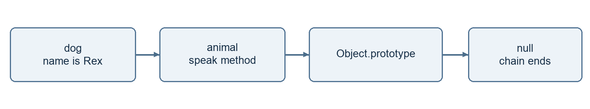
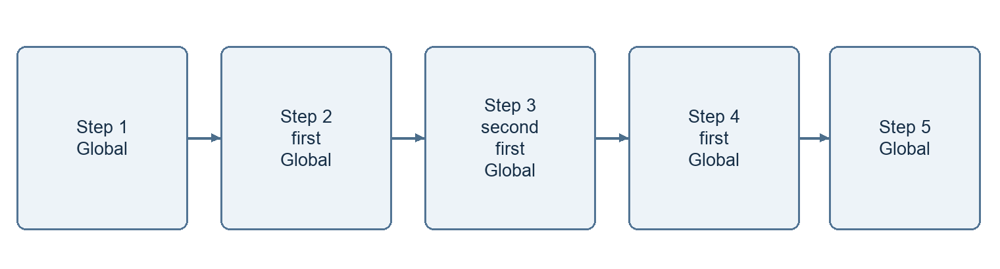
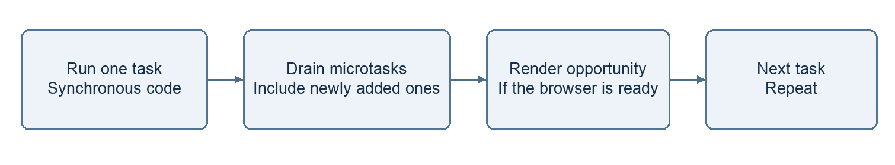
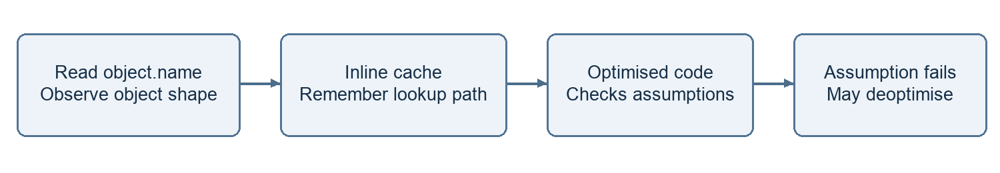

# Day 3 JavaScript in Depth

## What I want to understand

I want to understand what happens when my JavaScript code runs. These notes cover scope, functions, objects, async code, memory and engine behaviour. I also explain the order of mixed promises and timers, and how a closure can keep unwanted memory alive.

I use small examples so I can follow each step. Each code block is a separate example unless I give file names. I use a browser for the event loop examples. Node.js has extra scheduling rules.

### My reading order

1. I start with variables, scope, functions and objects.

2. I learn how values, modules and the call stack work.

3. I follow promises, timers and the event loop.

4. I study memory, metaprogramming and engine behaviour.

5. I use these ideas to explain the two research tasks.

I keep the browser rendering notes in Day 2. Here I focus on JavaScript and the two Day 3 research questions.

## Variables scope and hoisting

I use const when I do not need to assign a new value. I use let when the value must change. I usually avoid var in new code.

Scope means where I can use a name. A function creates function scope. A block is a section inside curly braces. let and const stay inside their block. var belongs to its function or global scope.

```javascript
if (true) {
  var city = "Dhaka"
  let score = 10
  const user = { name: "Mina" }
  user.name = "Rima"
}
console.log(city) // Dhaka
// console.log(score) would throw ReferenceError
```

const stops reassignment. It does not freeze an object. I can change user.name inside the block.

### What happens before a declaration runs

Hoisting is a name for declaration setup before execution. JavaScript does not move my source code. var starts as undefined. A function declaration is available with its body. let and const start uninitialised.

```javascript
console.log(total) // undefined
var total = 20
// Run the next example separately
console.log(price) // ReferenceError
let price = 50
```

The temporal dead zone lasts from the start of the scope until the declaration initialises the binding. I cannot read that let or const during this time. A const declaration needs an initial value.

## Functions and closures

I use a function to group work. A parameter receives an input. return sends a value back. A function without an explicit return gives undefined.

```javascript
function add(a, b) {
  return a + b
}
console.log(add(2, 3)) // 5
const double = n => n * 2
console.log(double(4)) // 8
```

A function declaration can be called before its declaration runs. An arrow or function expression follows the rules of its variable. A const function cannot be called before initialisation.

### How I understand a closure

A closure lets a function keep access to outer variables. The outer function can finish. The returned function can still use those variables. It keeps access to the binding, not a frozen copy.

```javascript
function makeCounter() {
  let count = 0
  return function () {
    count += 1
    return count
  }
}
const next = makeCounter()
console.log(next()) // 1
console.log(next()) // 2
```

1. I call makeCounter. It creates count with the value 0.

2. The inner function is returned and stored in next.

3. The outer call ends. next still has access to count.

4. Each call to next updates the same count binding.

I can use a closure for private state. Each new call to makeCounter creates a separate count binding.

## Arrow functions and this

For a regular function, I check how it is called to understand this. In user.greet(), this is user. If I copy the method into a variable, the connection is lost.

```javascript
"use strict"
const user = {
  name: "Mina",
  greet() {
    return this.name
  }
}
console.log(user.greet()) // Mina
const greet = user.greet
// greet() would throw TypeError
console.log(greet.call({ name: "Rima" })) // Rima
const fixed = greet.bind(user)
console.log(fixed()) // Mina
```

In a plain strict mode call, this is undefined. call runs a function with a chosen this. apply does the same with an array of arguments. bind returns a new function. It does not call it immediately. With new, this normally refers to the new instance.

### An arrow takes this from outside

```javascript
const counter = {
  value: 0,
  schedule() {
    setTimeout(() => {
      this.value += 1
      console.log(this.value) // 1
    }, 0)
  }
}
counter.schedule()
```

The arrow uses this from schedule. Here schedule is called on counter. An arrow has no own this or arguments. I cannot use it as a constructor with new. I avoid an arrow when a method needs this from its caller.

## Objects prototypes and classes

An object stores properties. A prototype is another object that can provide properties. I first look on the object itself. If a property is missing, JavaScript follows the prototype chain.

```javascript
const animal = {
  speak() {
    return this.name + " makes a sound"
  }
}
const dog = Object.create(animal)
dog.name = "Rex"
console.log(dog.speak()) // Rex makes a sound
console.log(Object.hasOwn(dog, "speak")) // false
```



This diagram shows the prototype lookup chain.

This is inheritance. dog uses speak from animal. The chain ends at null. A normal missing property read gives undefined after the whole chain is checked.

```javascript
class Person {
  constructor(name) {
    this.name = name
  }
  greet() {
    return "Hello " + this.name
  }
}
class Intern extends Person {
  greet() {
    return super.greet() + " from an intern"
  }
}
console.log(new Intern("Mina").greet())
```

A class uses the prototype system. Instance methods are usually shared through the prototype. extends creates inheritance. super reaches the parent behaviour. Classes also have their own rules, such as strict mode and private fields.

## Values coercion and equality

I have seven primitive types. They are string, number, boolean, undefined, null, bigint and symbol. Primitive values are immutable. I can reassign a let variable to a different value.

Objects include arrays and functions. I often call them reference types. JavaScript copies values on assignment. For an object, the copied value refers to the same object. JavaScript still passes arguments by value.

```javascript
let a = 10
let b = a
b = 20
console.log(a) // 10
const first = { score: 1 }
const second = first
second.score = 2
console.log(first.score) // 2
console.log(first === second) // true
console.log({ score: 2 } === { score: 2 }) // false
```

### When JavaScript changes a type for me

Type coercion is automatic conversion. I prefer explicit conversion when I need a number or string. A string with + can join text. Other operators can follow different rules.

```javascript
console.log("5" + 2) // "52"
console.log(Number("5") + 2) // 7
console.log("5" == 5) // true
console.log("5" === 5) // false
console.log(null == undefined) // true
console.log(null === undefined) // false
console.log(Boolean([])) // true
console.log(Number.isNaN(NaN)) // true
```

== can convert values before comparison. === does not convert their types. I use === by default. For objects, both compare identity. NaN === NaN is false. typeof null returns "object", but null is a primitive.

## ES modules import and export

I use modules to split code into files. Each module has its own scope. export shares a value. import gives another file access to it. Modules run in strict mode.

### math.js

```javascript
export function add(a, b) {
  return a + b
}
export const currency = "BDT"
export default function double(n) {
  return n * 2
}
```

### app.js

```javascript
import double, { add, currency } from "./math.js"
console.log(add(2, 3)) // 5
console.log(double(4)) // 8
console.log(currency) // BDT
```

### index.html

```html
<script type="module" src="./app.js"></script>
```

1. The browser finds app.js as a module.

2. It loads the required module files.

3. It connects imports to exports.

4. It evaluates dependencies before the importing code in this simple example.

A file can have many named exports and one default export. Named imports use braces. I can rename one with as. A default import can use a name I choose.

Imported bindings are live and read only to the importing file. I cannot reassign an imported binding. An exported object can still be mutable. I use a local web server for browser modules. Node.js can use .mjs or a package setting with "type": "module".

## Execution context call stack and heap

I think of an execution context as the information needed for one run. It includes variable bindings and scope information. For a regular function, it also tracks how this is resolved. Scripts and modules have their own contexts.

The creation and execution phases are a useful learning model. Setup creates bindings for the relevant scope. Execution runs the code. It does not mean every variable in the whole program is created at once.

```javascript
function second() {
  console.log("Hello")
}
function first() {
  second()
}
first()
```



This diagram follows the active calls on the stack.

I read each stack from the bottom upward. Only the top context runs. second finishes first. first resumes and then finishes. A function also leaves the stack when it throws. Some contexts can pause, such as generators.

### The heap stores allocated objects


This diagram shows two references to the same object.

The stack tracks active calls. The heap holds allocated data such as objects. Real storage is an engine detail. I do not assume every primitive always lives on the stack. A closure can keep data alive after a call ends. Recursion without a stopping condition can overflow the stack.

## Callbacks promises and async await

A callback is a function passed to another function. It may run now or later. Array map callbacks run synchronously. A timer callback runs later.

```javascript
console.log([1, 2].map(n => n * 2)) // [2, 4]
setTimeout(() => console.log("Later"), 0)
```

A promise represents a future result. Its state starts as pending. It can become fulfilled or rejected. A new Promise executor runs immediately. Its then and catch handlers run later as microtasks.

```javascript
const result = Promise.resolve(10)
result
  .then(value => value * 2)
  .then(value => console.log(value)) // 20
  .catch(error => console.log(error.message))
```

An async function always returns a promise. await pauses that function until the value settles. It does not block the whole page. CPU work before or after await can still block the main thread.

```javascript
async function loadUser() {
  try {
    const response = await fetch("/api/user")
    if (!response.ok) {
      throw new Error("Request failed")
    }
    const user = await response.json()
    console.log(user)
  } catch (error) {
    console.log(error.message)
  } finally {
    console.log("Loading finished")
  }
}
loadUser()
```

fetch does not reject just because a server returns HTTP 404. I check response.ok. try and catch handles rejected promises that I await. I use finally for cleanup. A later timer error needs handling inside that timer callback.

## Event loop tasks and microtasks

The browser handles timers and network activity outside my current JavaScript call. Ready callbacks wait until JavaScript can run them. They do not interrupt the current synchronous code.



This diagram shows a simple browser event loop.

A timer callback is a task. Promise reactions and queueMicrotask callbacks are microtasks. At the checkpoint after a task, the browser drains microtasks. New microtasks join that drain. Rendering can happen at a rendering opportunity. It does not happen after every task.

```javascript
console.log("A")
setTimeout(() => console.log("B"), 0)
Promise.resolve().then(() => console.log("C"))
queueMicrotask(() => console.log("D"))
console.log("E")
```

### My expected output

```text
A
E
C
D
B
```

1. A and E print during the current synchronous code.

2. The promise reaction is queued before the explicit microtask.

3. C and D print when the microtasks drain.

4. The timer task later prints B. Zero means a delay threshold, not immediate execution.

Too many microtasks can delay user input and rendering. await Promise.resolve() does not guarantee a paint. Browser scheduling is different from Node.js scheduling. I keep the environment clear when I predict output.

## Iterators and generators

An iterable can provide an iterator through Symbol.iterator. An iterator has next(). Each next call returns an object with value and done. done is true when the sequence ends.

```javascript
const names = ["Mina", "Rima"]
const iterator = names[Symbol.iterator]()
console.log(iterator.next())
// { value: "Mina", done: false }
console.log(iterator.next())
// { value: "Rima", done: false }
console.log(iterator.next())
// { value: undefined, done: true }
```

for of uses this protocol for me. Arrays, strings, Map and Set are iterable. A plain object is not iterable by default. I can use Object.entries to loop through its own entries.

### A generator can pause and resume

```javascript
function* numbers() {
  yield 1
  yield 2
  return 3
}
const values = numbers()
console.log(values.next()) // { value: 1, done: false }
console.log(values.next()) // { value: 2, done: false }
console.log(values.next()) // { value: 3, done: true }
console.log([...numbers()]) // [1, 2]
```

1. Calling numbers creates a generator object. The body has not run yet.

2. The first next runs to the first yield.

3. The next call resumes after that yield.

4. return ends the generator. Its final return value is skipped by for of and spread.

I can use a generator for values that I want to produce only when needed. A generator is not automatically asynchronous. Async generators use async function* and can work with for await of.

## Garbage collection and weak references

JavaScript allocates memory when I create values. The garbage collector can reclaim unreachable objects. It does not know whether I still want a reachable object. I cannot choose the exact collection time.

### My simple mark and sweep model

1. The collector starts from roots such as active contexts and global references.

2. It follows references and marks reachable objects.

3. Unreachable objects become eligible for collection. Real engines use more advanced methods too.

An unreachable cycle can be collected. Two objects pointing at each other do not automatically cause a leak. A path from a live root is what matters.

### Leaks I need to watch for

A timer can retain its callback. A global cache can keep growing. A listener can retain a closure. A removed DOM node can stay alive through a stored reference. I clear timers, remove unneeded listeners and limit caches.

```javascript
const metadata = new WeakMap()
let item = { name: "Mina" }
metadata.set(item, { visits: 1 })
item = null
```

A WeakMap does not keep an object key alive by itself. I cannot list its keys. I use it for metadata tied to an object lifetime.

```javascript
let item = { name: "Rima" }
const weak = new WeakRef(item)
item = null
const found = weak.deref()
console.log(found?.name)
```

deref can return the object or undefined in general. In this example, the object was created and used in the same synchronous job, so it remains available during that job. A later job may find it collected. I do not use WeakRef for required cleanup or important program logic. I use heap snapshots to inspect retained objects.

## Proxy Reflect and property descriptors

Metaprogramming means code that changes or observes how other code behaves. A Proxy can intercept operations such as reading and writing a property. A trap is the function that handles an intercepted operation.

```javascript
const user = { name: "Mina" }
const tracked = new Proxy(user, {
  get(target, key, receiver) {
    console.log("Reading", key)
    return Reflect.get(target, key, receiver)
  }
})
console.log(tracked.name) // Reading name, then Mina
```

Reflect provides methods for normal object operations. Reflect.get forwards this read and preserves receiver behaviour for getters. A Proxy must respect object invariants. It cannot invent any result for every operation.

### A descriptor controls one property

```javascript
"use strict"
const settings = {}
Object.defineProperty(settings, "version", {
  value: 1,
  writable: false,
  enumerable: true,
  configurable: false
})
console.log(settings.version) // 1
console.log(Object.keys(settings)) // ["version"]
// settings.version = 2 would throw TypeError
```

writable controls assignment to a data property. enumerable controls whether it appears in operations such as Object.keys. configurable controls deletion and most descriptor changes. With defineProperty, omitted flags default to false for a new property.

An accessor descriptor uses get and set instead of value and writable. I can inspect a descriptor with Object.getOwnPropertyDescriptor. A descriptor affects one property. It does not freeze a whole nested object.

## V8 hidden classes and inline caches

V8 is a JavaScript engine used by Chrome and Node.js. A hidden class describes an object shape. V8 also calls it a Map. This internal Map is different from the JavaScript Map collection.

```javascript
function makeUser(name, age) {
  return { name, age }
}
function readName(user) {
  return user.name
}
const first = makeUser("Mina", 22)
const second = makeUser("Rima", 23)
console.log(readName(first))
console.log(readName(second))
```

Objects with similar property setup can share a hidden class. Adding properties in a different order can produce another shape. Shape information can help V8 find a property efficiently.



This diagram shows a simple view of shape feedback in V8.

An inline cache records useful lookup information at a code location. If the expected shape appears again, V8 can reuse a fast path. A site can learn one shape or several shapes.

Optimised code relies on assumptions. If an assumption fails, V8 may deoptimise and use a more general path. A new shape does not always cause deoptimisation. The effect depends on the code and engine version.

I keep object setup consistent where practical. I profile before making performance changes. Hidden classes and optimisation tiers are engine details. They are not JavaScript language rules.

## Concurrency parallelism and cancellation

Concurrency means more than one operation can make progress over an overlapping period. Parallelism means work runs at the same time. Waiting for two requests can be concurrent without running two JavaScript callbacks at once.

```javascript
async function loadBoth() {
  const userRequest = fetch("/api/user")
  const postsRequest = fetch("/api/posts")
  const [user, posts] = await Promise.all([
    userRequest,
    postsRequest
  ])
  return [user, posts]
}
```

Both requests start before I await them. Promise.all waits for all fulfilments or rejects on a rejection. It does not create CPU threads. It does not cancel the other requests when one fails. Workers can run CPU work on separate threads. A browser worker cannot directly change the DOM.

### I cancel a request with AbortController

```javascript
const controller = new AbortController()
async function load() {
  try {
    const response = await fetch("/api/user", {
      signal: controller.signal
    })
    if (!response.ok) throw new Error("Request failed")
    console.log(await response.json())
  } catch (error) {
    if (error.name === "AbortError") {
      console.log("Cancelled")
    } else {
      console.log(error.message)
    }
  }
}
load()
controller.abort()
```

abort sends a cancellation signal. The API must support it. It does not stop an arbitrary loop or undo work already done by a server. After abort, I need a new controller for a new operation.

## Mixed promises timers and synchronous code

I predict this example as a browser script. I first mark synchronous lines. Then I track microtasks in queue order. Finally I follow timer tasks.

```javascript
console.log("A")
setTimeout(() => {
  console.log("B")
  Promise.resolve().then(() => console.log("C"))
}, 0)
new Promise(resolve => {
  console.log("D")
  resolve()
}).then(() => {
  console.log("E")
  queueMicrotask(() => console.log("F"))
})
async function run() {
  console.log("G")
  await Promise.resolve()
  console.log("H")
}
run()
console.log("I")
```

### My predicted output

```text
A
D
G
I
E
H
F
B
C
```

1. A prints. The browser registers the timer.

2. The promise executor runs immediately and prints D. Its then handler queues E.

3. run starts immediately and prints G. await queues the continuation for H.

4. I prints. The synchronous script is finished.

5. E runs first and adds F behind H. H runs next. Then F runs.

6. The timer task prints B. It queues C. C runs at the next microtask checkpoint.

The timer delay does not give B priority over microtasks. I always include microtasks created by another microtask. I also check microtasks after a timer task.

## How a closure can retain unwanted memory

A closure is useful. It becomes part of a leak when something long lived keeps it reachable and it retains data I no longer need. Finishing the outer function does not break that reference path.

```javascript
function mount() {
  const rows = new Array(100000).fill("saved data")
  function showSize() {
    console.log(rows.length)
  }
  window.addEventListener("resize", showSize)
  return function cleanup() {
    window.removeEventListener("resize", showSize)
  }
}
let cleanup = mount()
// When the view is no longer needed
cleanup()
cleanup = null
```


This diagram shows how a listener can keep captured data alive.

1. mount creates rows and showSize. showSize captures rows.

2. window keeps the registered listener. The listener keeps access to rows.

3. If I leave the listener registered, the data stays reachable after mount ends. Repeated mounts can retain more data.

4. I call cleanup to remove the same listener function.

5. I also drop cleanup. It can retain showSize and its captured data. With no other path, the data becomes eligible for collection.

Removing a DOM element alone does not remove all references to it. I also check timers, caches and stored callbacks. I can compare heap snapshots after repeated mount and cleanup cycles. Collection is not guaranteed to happen immediately.

## References

I use these references when I need to check the language rules or engine details. The diagrams are simple learning views.

JavaScript guide
https://developer.mozilla.org/en-US/docs/Web/JavaScript/Guide

Execution model
https://developer.mozilla.org/en-US/docs/Web/JavaScript/Reference/Execution_model

Using microtasks
https://developer.mozilla.org/en-US/docs/Web/API/HTML_DOM_API/Microtask_guide

Memory management
https://developer.mozilla.org/en-US/docs/Web/JavaScript/Guide/Memory_management

WeakRef
https://developer.mozilla.org/en-US/docs/Web/JavaScript/Reference/Global_Objects/WeakRef

AbortController
https://developer.mozilla.org/en-US/docs/Web/API/AbortController

V8 hidden classes
https://v8.dev/docs/hidden-classes

V8 fast properties
https://v8.dev/blog/fast-properties
