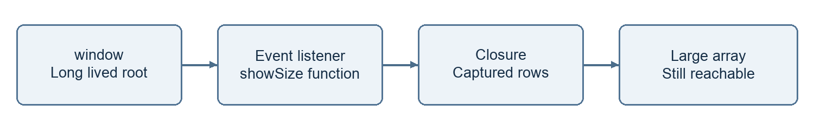

# Day 3 Research Task

I use the two worked examples from my [JavaScript notes](notes.md): execution order and memory retained by a closure.

## Task 1 Predict and explain the execution order

I predict this example as a browser script. I first mark synchronous lines. Then I track microtasks in queue order. Finally I follow timer tasks.

```javascript
console.log("A")
setTimeout(() => {
  console.log("B")
  Promise.resolve().then(() => console.log("C"))
}, 0)
new Promise(resolve => {
  console.log("D")
  resolve()
}).then(() => {
  console.log("E")
  queueMicrotask(() => console.log("F"))
})
async function run() {
  console.log("G")
  await Promise.resolve()
  console.log("H")
}
run()
console.log("I")
```

### My predicted output

```text
A
D
G
I
E
H
F
B
C
```

1. A prints. The browser registers the timer.

2. The promise executor runs immediately and prints D. Its then handler queues E.

3. run starts immediately and prints G. await queues the continuation for H.

4. I prints. The synchronous script is finished.

5. E runs first and adds F behind H. H runs next. Then F runs.

6. The timer task prints B. It queues C. C runs at the next microtask checkpoint.

The timer delay does not give B priority over microtasks. I always include microtasks created by another microtask. I also check microtasks after a timer task.

## Task 2 Explain how a closure can cause a memory leak

A closure is useful. It becomes part of a leak when something long lived keeps it reachable and it retains data I no longer need. Finishing the outer function does not break that reference path.

```javascript
function mount() {
  const rows = new Array(100000).fill("saved data")
  function showSize() {
    console.log(rows.length)
  }
  window.addEventListener("resize", showSize)
  return function cleanup() {
    window.removeEventListener("resize", showSize)
  }
}
let cleanup = mount()
// When the view is no longer needed
cleanup()
cleanup = null
```



This diagram shows how a listener can keep captured data alive.

1. mount creates rows and showSize. showSize captures rows.

2. window keeps the registered listener. The listener keeps access to rows.

3. If I leave the listener registered, the data stays reachable after mount ends. Repeated mounts can retain more data.

4. I call cleanup to remove the same listener function.

5. I also drop cleanup. It can retain showSize and its captured data. With no other path, the data becomes eligible for collection.

Removing a DOM element alone does not remove all references to it. I also check timers, caches and stored callbacks. I can compare heap snapshots after repeated mount and cleanup cycles. Collection is not guaranteed to happen immediately.


## References

[MDN microtask guide](https://developer.mozilla.org/en-US/docs/Web/API/HTML_DOM_API/Microtask_guide)

[MDN memory management](https://developer.mozilla.org/en-US/docs/Web/JavaScript/Guide/Memory_management)
