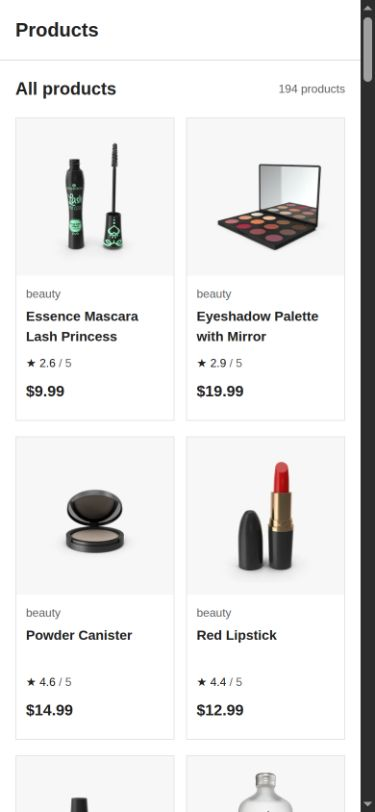
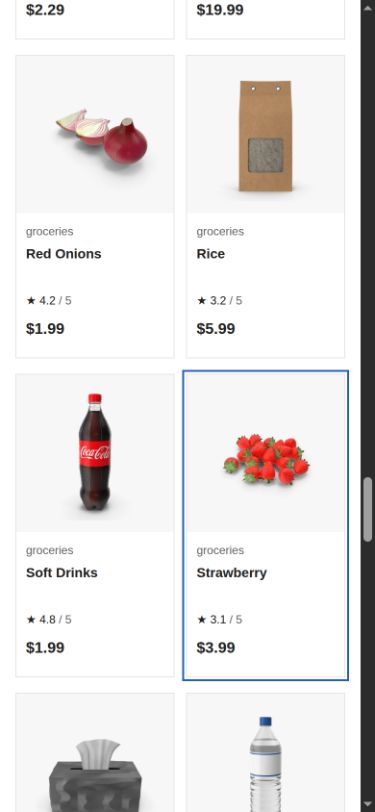
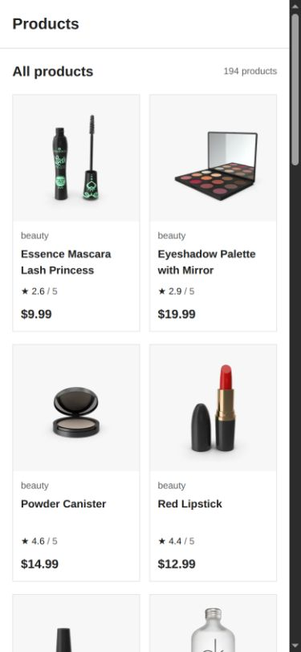
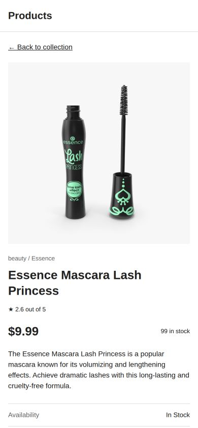

# React Product Listing — Lazy Loading + Virtualization

Virtualized version of the neighboring `SEOAssignment` project, with the same design and routes. Built with **React, Vite, JavaScript, plain CSS and React Router**. Product data comes from [DummyJSON](https://dummyjson.com/docs/products). No login or API key is needed.

## Screenshots

| Virtual list at the top | Scrolled virtual window |
| --- | --- |
|  |  |

The shared product detail design is shown below.

| Product list | Product details |
| --- | --- |
|  |  |

## Run locally

Use Node.js 22.12+ and npm.

```bash
cd "/home/saikat/Desktop/robendevs-swe-foundation-saikat/day-06-Frontend Frameworks: React/SEOAssignment-Virtualized"
npm ci
npm run dev
```

Open the URL printed in the terminal (usually `http://localhost:5173`). Stop the server with **Ctrl+C**.

For production testing:

```bash
npm run build
npm run preview
```

Open the printed preview URL (usually `http://localhost:4173`). `build` creates optimized files in `dist`; `preview` serves those files locally. Both modes still use client-side rendering.

The npm scripts call Vite through its local file path because the parent folder contains `:`, which can break executable lookup on Linux. No global Vite installation is needed.

## Features

- Responsive two-column list; both pages stay at most 480px wide.
- Infinite scrolling with two API batches per loading cycle.
- Individual product details at `/products/:id`, with a back link.
- Loading placeholders, image fallbacks, error/retry and end-of-results messages.
- Request guard, duplicate-ID filtering and cancellation when leaving a page.
- Lazy images and a separate JavaScript chunk for the detail page.
- Virtualization: off-screen cards leave the DOM and return when scrolling back.

## Main files

```text
src/
├── main.jsx                   # Starts React and BrowserRouter
├── App.jsx                    # Header, routes and lazy detail import
├── api.js                     # Fetch helpers, batch size and price formatting
├── virtualization.js         # Calculates row sizes and visible range
├── styles.css                 # Shared layout and styles
├── components/
│   ├── ProductCard.jsx        # One clickable product card
│   ├── VirtualProductGrid.jsx # Renders the moving card window
│   └── ProductImage.jsx       # Image loading and error fallback
└── pages/
    ├── ProductList.jsx        # Product state, loadMore() and scroll observer
    └── ProductDetail.jsx      # Fetches one product using the URL ID
```

`index.html` is the HTML shell. `vite.config.js` enables the React plugin. `package.json` contains commands/dependencies; `package-lock.json` records exact versions. `public/favicon.svg` is the browser icon, and `docs/screenshots/` stores the images above. `.gitignore` excludes `node_modules` and `dist`.

## How loading works

```text
React app → ProductList → api.js → DummyJSON → ProductCards
                 ↑                                  ↓
                 └──── bottom scroll observer ──────┘

ProductCard click → /products/:id → detail API → ProductDetail
```

In `api.js`, `BATCH_SIZE = 10` means **10 products per request**. `loadMore()` in `ProductList.jsx` makes **two requests together** using `Promise.all`, so a normal cycle adds 20 products.

| Cycle | Request 1 | Request 2 | Products loaded so far* |
| --- | --- | --- | --- |
| 1 | `limit=10&skip=0` | `limit=10&skip=10` | 20 |
| 2 | `limit=10&skip=20` | `limit=10&skip=30` | 40 |
| 3 | `limit=10&skip=40` | `limit=10&skip=50` | 60 |

*Assuming enough products and no duplicate IDs; the last cycle can be smaller.*

- **`limit`**: সর্বোচ্চ কতটি product আনবে।
- **`skip` / `nextSkip`**: শুরু থেকে কতটি বাদ দেবে; starts at 0 and advances by 20.
- **`products.length`**: এখন পর্যন্ত কতটি unique product জমেছে।
- **`incoming.length`**: এই cycle-এর দুই response মিলিয়ে কতটি এসেছে।
- **`total`**: API-তে মোট কতটি product আছে; not hardcoded.

The first effect calls `loadMore()`. After that, `IntersectionObserver` watches the bottom marker with a 300px margin and loads the next pair as you approach it. The button is a manual alternative.

Both requests must succeed before data is appended. IDs are deduplicated with a `Set`. A failed cycle keeps the same offset for retry. Loading stops when `nextSkip >= total`, or both responses are empty. Returning to the list starts again from the first cycle.

## Batch size vs lazy loading

**Batch size decides how much to load; lazy loading decides when to load.**

- **Data:** infinite scrolling delays the next pair of batches until needed.
- **Images:** `ProductImage.jsx` uses `loading="lazy"` for other card images. The first card image and detail hero use eager loading with high fetch priority.
- **Code:** `App.jsx` uses `lazy(() => import(...))` to load the detail module when its route is opened. `Suspense` shows a loading message meanwhile.

Image dimensions, square containers and initial placeholders help keep the layout stable. System fonts and plain CSS avoid extra font/UI-library downloads.

## CSR vs SSR

This app uses **Client-Side Rendering (CSR)**:

```text
Browser receives HTML shell → runs React → fetches data → displays products
```

With **SSR**, a server would fetch data and send product HTML first, then React would hydrate it in the browser. `async/await`, `build` and `preview` do not turn CSR into SSR. SSR is not implemented here.

Product content currently requires JavaScript. Client-side titles and a Lighthouse SEO score do not guarantee search indexing.

## Test with Chrome

1. Run `npm run build`, then `npm run preview`.
2. Open the preview URL → DevTools → **Lighthouse**.
3. Select **Mobile**, and enable **Performance, Accessibility, Best Practices and SEO**.
4. Run the audit. Test the list and `/products/1` separately, using the same settings when comparing reports.
5. Inspect **LCP, CLS and Total Blocking Time**. Use the Performance panel to record scrolling/clicks and investigate responsiveness; a page-load Lighthouse score is not a real-user INP measurement.

Also check scrolling, keyboard navigation, retry after blocking API requests, an invalid product ID, and narrow screen widths. In Network → Fetch/XHR, the list should request skips `0, 10`, then `20, 30`.

No Lighthouse score has been measured for this virtualized version. The original version’s score does not apply here.

When deploying `dist` to a static host, configure an SPA fallback to `index.html` so refreshing a URL such as `/products/1` works.

## What virtualization changes

| Version | Folder | Loaded data | Product cards in the DOM |
| --- | --- | --- | --- |
| Lazy loading only | `../SEOAssignment` | Grows by up to 20 per cycle | Every loaded product |
| Lazy loading + virtualization | This folder | Same API batches | Normally 20 near the viewport |

`VirtualProductGrid.jsx` uses `getWindow()` from `virtualization.js`:

1. Two cards form one row. The card image stays square; its information area is fixed at 150px so row heights are predictable.
2. The virtual list reserves the full height of all loaded rows. Removing cards does not shorten the page.
3. Scroll position determines the first visible row. Two extra rows above help avoid blank edges.
4. Normally 10 rows (20 cards) are rendered. A very tall viewport gets enough extra rows to fill it. A keyboard-focused card may stay mounted as one additional card.
5. Cards are positioned at their original row coordinates. When the window moves down, earlier cards unmount; when it moves up, they remount from the existing product data.
6. A passive scroll listener schedules at most one update per animation frame. ResizeObserver updates the layout if the list width changes. Listeners are cleaned up on unmount.
7. Tab/Shift+Tab can move through loaded cards even at a virtual-window boundary. List items announce their position within the loaded set.

**Data is not deleted:** product objects remain in React state. This reduces DOM/rendering work, not the memory needed for the downloaded data. Image remounting can use the browser cache, but cache reuse is not guaranteed. Browser Find and screen readers only have access to mounted cards at that moment.

### Local dependencies and storage

For this local comparison, `node_modules` is an ignored symlink to `../SEOAssignment/node_modules` to avoid duplicating the installed packages. No new package was added. If installing independently or after cloning, run `npm ci` in this folder. If the original folder is removed, this version needs its own install.

### Verify virtualization

```bash
npm test
npm run build
npm run preview
```

Open DevTools → Elements and search for `.product-card`. Load several batches and scroll down: the loaded count grows while normally about 20 card elements remain. Scroll up: the first products return without another data request for those products. Test Tab/Shift+Tab, window resizing and detail links too. Returning from details resets the list, just like the original version.

Three automated tests cover range limits, stable total height, upward restoration, a partial final batch and different viewport sizes.

### Verification

- `npm test`: 3 tests passed. `npm run build`: passed.
- Browser check: 60 products loaded, 20 cards mounted. After scrolling down the mounted indices were 30–49; returning to the top restored 0–19 while the reserved height stayed 9929px in that mobile session.
- Tab crossed from product index 19 to 20 successfully. Narrow and wider mobile views had no horizontal overflow. Detail routing was also checked.
