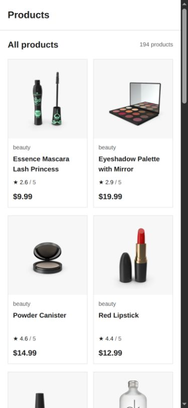
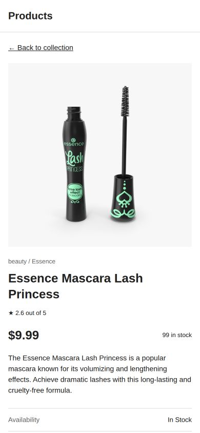

# React Product Listing

A simple mobile-style product catalog built with **React, Vite, JavaScript, plain CSS and React Router**. Product data comes from [DummyJSON](https://dummyjson.com/docs/products). No login or API key is needed.

## Screenshots

| Product list | Product details |
| --- | --- |
|  |  |

## Run locally

Use Node.js 22.12+ and npm.

```bash
cd "/home/saikat/Desktop/robendevs-swe-foundation-saikat/day-06-Frontend Frameworks: React/SEOAssignment"
npm ci
npm run dev
```

Open the URL printed in the terminal (usually `http://localhost:5173`). Stop the server with **Ctrl+C**.

For production testing:

```bash
npm run build
npm run preview
```

Open the printed preview URL (usually `http://localhost:4173`). `build` creates optimized files in `dist`; `preview` serves those files locally. Both modes still use client-side rendering.

The npm scripts call Vite through its local file path because the parent folder contains `:`, which can break executable lookup on Linux. No global Vite installation is needed.

## Features

- Responsive two-column list; both pages stay at most 480px wide.
- Infinite scrolling with two API batches per loading cycle.
- Individual product details at `/products/:id`, with a back link.
- Loading placeholders, image fallbacks, error/retry and end-of-results messages.
- Request guard, duplicate-ID filtering and cancellation when leaving a page.
- Lazy images and a separate JavaScript chunk for the detail page.

## Main files

```text
src/
├── main.jsx                   # Starts React and BrowserRouter
├── App.jsx                    # Header, routes and lazy detail import
├── api.js                     # Fetch helpers, batch size and price formatting
├── styles.css                 # Shared layout and styles
├── components/
│   ├── ProductCard.jsx        # One clickable product card
│   └── ProductImage.jsx       # Image loading and error fallback
└── pages/
    ├── ProductList.jsx        # Product state, loadMore() and scroll observer
    └── ProductDetail.jsx      # Fetches one product using the URL ID
```

`index.html` is the HTML shell. `vite.config.js` enables the React plugin. `package.json` contains commands/dependencies; `package-lock.json` records exact versions. `public/favicon.svg` is the browser icon, and `docs/screenshots/` stores the images above. `.gitignore` excludes `node_modules` and `dist`.

## How loading works

```text
React app → ProductList → api.js → DummyJSON → ProductCards
                 ↑                                  ↓
                 └──── bottom scroll observer ──────┘

ProductCard click → /products/:id → detail API → ProductDetail
```

In `api.js`, `BATCH_SIZE = 10` means **10 products per request**. `loadMore()` in `ProductList.jsx` makes **two requests together** using `Promise.all`, so a normal cycle adds 20 products.

| Cycle | Request 1 | Request 2 | Products loaded so far* |
| --- | --- | --- | --- |
| 1 | `limit=10&skip=0` | `limit=10&skip=10` | 20 |
| 2 | `limit=10&skip=20` | `limit=10&skip=30` | 40 |
| 3 | `limit=10&skip=40` | `limit=10&skip=50` | 60 |

*Assuming enough products and no duplicate IDs; the last cycle can be smaller.*

- **`limit`**: সর্বোচ্চ কতটি product আনবে।
- **`skip` / `nextSkip`**: শুরু থেকে কতটি বাদ দেবে; starts at 0 and advances by 20.
- **`products.length`**: এখন পর্যন্ত কতটি unique product জমেছে।
- **`incoming.length`**: এই cycle-এর দুই response মিলিয়ে কতটি এসেছে।
- **`total`**: API-তে মোট কতটি product আছে; not hardcoded.

The first effect calls `loadMore()`. After that, `IntersectionObserver` watches the bottom marker with a 300px margin and loads the next pair as you approach it. The button is a manual alternative.

Both requests must succeed before data is appended. IDs are deduplicated with a `Set`. A failed cycle keeps the same offset for retry. Loading stops when `nextSkip >= total`, or both responses are empty. Returning to the list starts again from the first cycle.

## Batch size vs lazy loading

**Batch size decides how much to load; lazy loading decides when to load.**

- **Data:** infinite scrolling delays the next pair of batches until needed.
- **Images:** `ProductImage.jsx` uses `loading="lazy"` for other card images. The first card image and detail hero use eager loading with high fetch priority.
- **Code:** `App.jsx` uses `lazy(() => import(...))` to load the detail module when its route is opened. `Suspense` shows a loading message meanwhile.

Image dimensions, square containers and initial placeholders help keep the layout stable. System fonts and plain CSS avoid extra font/UI-library downloads.

## CSR vs SSR

This app uses **Client-Side Rendering (CSR)**:

```text
Browser receives HTML shell → runs React → fetches data → displays products
```

With **SSR**, a server would fetch data and send product HTML first, then React would hydrate it in the browser. `async/await`, `build` and `preview` do not turn CSR into SSR. SSR is not implemented here.

Product content currently requires JavaScript. Client-side titles and a Lighthouse SEO score do not guarantee search indexing.

## Test with Chrome

1. Run `npm run build`, then `npm run preview`.
2. Open the preview URL → DevTools → **Lighthouse**.
3. Select **Mobile**, and enable **Performance, Accessibility, Best Practices and SEO**.
4. Run the audit. Test the list and `/products/1` separately, using the same settings when comparing reports.
5. Inspect **LCP, CLS and Total Blocking Time**. Use the Performance panel to record scrolling/clicks and investigate responsiveness; a page-load Lighthouse score is not a real-user INP measurement.

Also check scrolling, keyboard navigation, retry after blocking API requests, an invalid product ID, and narrow screen widths. In Network → Fetch/XHR, the list should request skips `0, 10`, then `20, 30`.

No measured Lighthouse report is included in this repository; scores depend on the device, network and test settings.

When deploying `dist` to a static host, configure an SPA fallback to `index.html` so refreshing a URL such as `/products/1` works.
