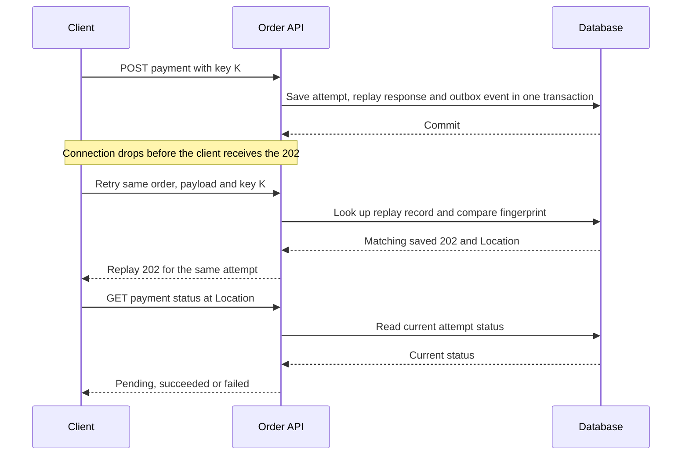

# Research Task — Order Service API Contracts

I design this API for a signed-in customer who creates an order, browses their order history and pays for an order. I use JSON over HTTPS and put the major version in `/api/v1`. I assume one successful full payment per order.

## 1. Resources and authentication

| Method and path | What I return |
| --- | --- |
| `POST /api/v1/orders` | `201 Created` with the order and a `Location` header. The client sends product IDs and quantities. I calculate the price and currency on the server. |
| `GET /api/v1/orders` | `200 OK` with a page of the caller's orders |
| `GET /api/v1/orders/{orderId}` | `200 OK` with one order, or `404` if it is missing or belongs to another customer |
| `POST /api/v1/orders/{orderId}/payments` | `202 Accepted` with a payment attempt and a `Location` header for its status |
| `GET /api/v1/orders/{orderId}/payments/{paymentId}` | `200 OK` with the attempt status, or `404` if the payment is unavailable to the caller |

I send `Authorization: Bearer <access-token>` with each request. If the access token is a JWT, I verify its signature, allowed algorithm, issuer, audience and expiry before using its subject. I require an order-read permission for reads and a payment-write permission for payment creation. I check order ownership separately. A token that permits payments cannot pay an order belonging to another customer. For a missing or invalid token, I send `401` with `WWW-Authenticate: Bearer`. For a valid token missing endpoint permission, I send `403`. I return `Cache-Control: no-store` on these private responses. [Bearer token usage](https://www.rfc-editor.org/rfc/rfc6750.html)

## 2. Cursor pagination

I list a customer's orders newest first, using `createdAt DESC, id DESC` so orders with the same timestamp have a stable order. I default to 20 results and accept a `limit` from 1 to 100. I allow a filter such as `status=pending_payment`.

```text
GET /api/v1/orders?status=pending_payment&limit=1
```

```json
{
  "items": [
    {
      "id": "ord_42",
      "status": "pending_payment",
      "amountMinor": 250000,
      "currency": "BDT",
      "createdAt": "2026-11-19T04:30:00Z"
    }
  ],
  "nextCursor": "example-opaque-cursor"
}
```

I return an opaque cursor that represents the last sort position and is bound to the customer and filter. The next request sends the same filter and `cursor=example-opaque-cursor`. I verify that the cursor is valid for that query and return `400` if it is malformed or used with a different filter. When there are no more results, `nextCursor` is `null`. If nothing matches, I return `200` with `items: []`. Cursor pagination helps me avoid rows shifting solely because a newer order was inserted. Changes to an order's filter status can still affect later pages.

## 3. Idempotent payment requests

I create one idempotency key for one payment attempt and keep it until I know the outcome. The client sends an opaque payment method reference from the payment provider. I verify the reference belongs to the caller and use the server's saved order total. I accept no amount or raw card data in this request.

```http
POST /api/v1/orders/ord_42/payments HTTP/1.1
Host: api.example.com
Authorization: Bearer <access-token>
Idempotency-Key: 4194dad9-14ab-4a39-bfc8-f118fd0786a0
Content-Type: application/json

{"paymentMethodId":"pm_example"}
```

```http
HTTP/1.1 202 Accepted
Location: /api/v1/orders/ord_42/payments/pay_18
Content-Type: application/json
Cache-Control: no-store

{"id":"pay_18","orderId":"ord_42","status":"pending"}
```

The accepted response tells me an attempt exists. I read the status URL to see whether it is `pending`, `succeeded` or `failed`. If the connection drops after I send the POST, I retry with the same key and payload.

| What reaches my API | What I do |
| --- | --- |
| First valid request with a new key | I save the attempt, its accepted response and an outbox event in one transaction. |
| Same key, same order and payload | I replay the saved `202`, body and `Location`. I use GET to return the current payment status. |
| Same key with a different order or payload | I return `409 IDEMPOTENCY_KEY_REUSED`. |
| Different key while this order has a pending payment or has already been paid | I return `409 PAYMENT_IN_PROGRESS` or `409 ORDER_ALREADY_PAID`. |

I scope the key to the customer and payment operation and store a fingerprint of the order ID and validated payload. I use database constraints or a transactional lock to protect both the idempotency record and the order's payment state when requests arrive together. I retain replay records for at least 24 hours in this proposal. Once the window closes, the client checks the order before starting a new attempt.

The worker uses the payment attempt ID as a stable idempotency key with the provider. If the provider call times out after a possible charge, I keep the attempt pending and reconcile it before accepting another attempt. I mark the order paid only when success is confirmed. After a definitive failure, the customer can start a new attempt with a new key.

The first POST below commits before the response is lost. A replay returns the saved acceptance response. GET shows the current status.



## 4. Consistent errors

I send `application/problem+json` using RFC 9457. I keep the HTTP status and body status aligned. Clients can branch on the stable problem type or the `code` extension. I include a request ID for support and use an optional `errors` array for field-level validation.

```json
{
  "type": "https://api.example.com/problems/idempotency-key-reused",
  "title": "Idempotency key already used",
  "status": 409,
  "detail": "This key was used for a different payment request.",
  "code": "IDEMPOTENCY_KEY_REUSED",
  "requestId": "req_8ad2"
}
```

| Status | Example problem code |
| --- | --- |
| `400` | `INVALID_CURSOR`, `INVALID_JSON` or `IDEMPOTENCY_KEY_REQUIRED` |
| `401` | `UNAUTHENTICATED` |
| `403` | `FORBIDDEN` |
| `404` | `ORDER_NOT_FOUND` or `PAYMENT_NOT_FOUND` |
| `409` | `IDEMPOTENCY_KEY_REUSED`, `PAYMENT_IN_PROGRESS` or `ORDER_ALREADY_PAID` |
| `422` | `VALIDATION_FAILED` |
| `429` | `RATE_LIMITED`, with `Retry-After` when I can provide a delay |
| `500` | `INTERNAL_ERROR` with a generic public message |

I keep provider responses, tokens and stack traces out of error bodies. [RFC 9457 Problem Details](https://www.rfc-editor.org/rfc/rfc9457.html)

## What I would verify in contract tests

- A token from another customer cannot read or pay an order, even with a known order ID.
- Two orders with the same timestamp still paginate without a duplicate in a fixed dataset.
- Concurrent requests with the same key create one attempt and outbox event. Both callers receive the same payment ID.
- Reusing a key with a different payment method returns the documented `409` problem body.
- If the provider outcome is unknown, a different client key cannot start a second charge while the original attempt is pending.
