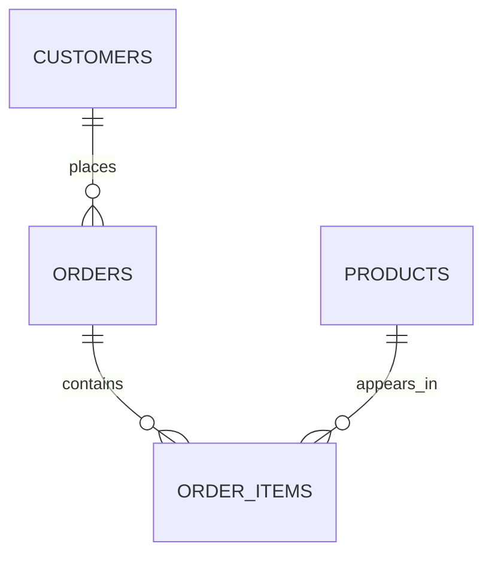

# Relational Modelling and SQL

A small shop database tracks customers, products, and orders. Each table holds one kind of record. A row describes one record, and its columns hold individual values.

| Table | What one row represents | Key |
| --- | --- | --- |
| `customers` | One customer | `customer_id` |
| `products` | One product and its current price | `product_id` |
| `orders` | One order placed by one customer | `order_id` |
| `order_items` | One product on one order, with its quantity and sale price | `(order_id, product_id)` |

## How the tables connect

A **primary key** identifies a row. Its value must be unique and cannot be missing. The `order_items` table uses a **composite primary key**. An order can contain several products, but the same product can appear only once per order. Its quantity records how many units were bought.

A **foreign key** points to a key in another table. For example, `orders.customer_id` must match a customer in `customers`. A customer can have zero or more orders. An order belongs to exactly one customer because its foreign key is also `NOT NULL`.

Orders and products have a **many-to-many** relationship. The `order_items` table stores these links with the quantity and sale price. Changing the current product price leaves past order totals intact.



In the diagram, `||` means exactly one and `o{` means zero or more. The schema allows an order to exist without any items. If the shop requires at least one item on a submitted order, check that rule when saving the order and its items in a transaction.

## What the constraints enforce

- `PRIMARY KEY` gives every row a stable identifier.
- `FOREIGN KEY` prevents a row from pointing to a record that does not exist.
- `NOT NULL` makes a value required.
- `UNIQUE` prevents duplicate values. Customer email uses it together with `NOT NULL`.
- `CHECK` enforces rules such as a positive quantity and a non-negative price.
- `DEFAULT` supplies a value when an insert leaves out the column. New orders default to `pending`.

## Schema and sample data

Run this block once in a fresh SQLite database. SQLite needs `PRAGMA foreign_keys = ON` for each connection that should enforce foreign keys. Prices use integer cents so the examples can use exact whole-number arithmetic.

```sql
PRAGMA foreign_keys = ON;

CREATE TABLE customers (
    customer_id INTEGER PRIMARY KEY,
    name TEXT NOT NULL,
    email TEXT NOT NULL UNIQUE
);

CREATE TABLE products (
    product_id INTEGER PRIMARY KEY,
    name TEXT NOT NULL,
    price_cents INTEGER NOT NULL CHECK (price_cents >= 0)
);

CREATE TABLE orders (
    order_id INTEGER PRIMARY KEY,
    customer_id INTEGER NOT NULL REFERENCES customers(customer_id),
    order_date TEXT NOT NULL,
    status TEXT NOT NULL DEFAULT 'pending'
        CHECK (status IN ('pending', 'paid', 'cancelled'))
);

CREATE TABLE order_items (
    order_id INTEGER NOT NULL REFERENCES orders(order_id),
    product_id INTEGER NOT NULL REFERENCES products(product_id),
    quantity INTEGER NOT NULL CHECK (quantity > 0),
    unit_price_cents INTEGER NOT NULL CHECK (unit_price_cents >= 0),
    PRIMARY KEY (order_id, product_id)
);

INSERT INTO customers VALUES
    (1, 'Asha', 'asha@example.com'),
    (2, 'Rafi', 'rafi@example.com'),
    (3, 'Mina', 'mina@example.com');

INSERT INTO products VALUES
    (1, 'Notebook', 500),
    (2, 'Pen', 200),
    (3, 'Bag', 2500),
    (4, 'Mug', 900);

INSERT INTO orders VALUES
    (101, 1, '2026-11-01', 'paid'),
    (102, 1, '2026-11-03', 'paid'),
    (103, 2, '2026-11-04', 'pending'),
    (104, 2, '2026-11-08', 'paid');

INSERT INTO order_items VALUES
    (101, 1, 2, 500),
    (101, 2, 3, 200),
    (102, 3, 1, 2500),
    (103, 1, 1, 500),
    (104, 2, 2, 200);
```

The dates use the `YYYY-MM-DD` format. SQLite stores them as text in this example.

## SQL Queries

Run these examples after loading the shop schema and sample data above. Prices and totals are in cents. In the results below, each parenthesised group is one row and its values follow the order of the selected columns.

### SELECT

Use `SELECT` to pick columns and calculate values. `FROM` names the table and `WHERE` filters its rows. `ORDER BY` sorts the result, and `LIMIT` keeps only the first few rows after sorting. Add a second sort column so ties have a clear order.

```sql
SELECT name, price_cents
FROM products
WHERE price_cents >= 500
ORDER BY price_cents DESC, product_id
LIMIT 2;
```

Result — `(Bag, 2500)`, `(Mug, 900)`.

Use `DISTINCT` to return each selected value or combination of values once. To find missing values, use `IS NULL`. A comparison such as `= NULL` does not test for missing values.

```sql
SELECT DISTINCT status
FROM orders
ORDER BY status;
```

Result — `(paid)`, `(pending)`.

### JOIN

Use `JOIN` when the columns live in different tables. `ON` describes how the rows match. The short names `oi` and `p` show which table each column comes from. An `INNER JOIN` returns only matching rows.

```sql
SELECT oi.order_id, p.name, oi.quantity,
       oi.quantity * oi.unit_price_cents AS line_total_cents
FROM order_items AS oi
INNER JOIN products AS p ON p.product_id = oi.product_id
WHERE oi.order_id = 101
ORDER BY p.product_id;
```

Result — `(101, Notebook, 2, 1000)`, `(101, Pen, 3, 600)`. The query uses the sale price stored on the order item.

A `LEFT JOIN` keeps every row from the left table. When there is no match, the columns from the right table are `NULL`. Put the paid-order filter in `ON` so that customers without paid orders stay in the result. Moving that filter to `WHERE` removes those customers.

```sql
SELECT c.name, o.order_id
FROM customers AS c
LEFT JOIN orders AS o
    ON o.customer_id = c.customer_id AND o.status = 'paid'
ORDER BY c.customer_id, o.order_id;
```

Result — `(Asha, 101)`, `(Asha, 102)`, `(Rafi, 104)`, `(Mina, NULL)`. Asha appears twice because she has two paid orders.

### GROUP BY

Use `GROUP BY` to turn several rows into one result per group. `COUNT` counts rows or non-null values, `SUM` adds values, and `AVG` finds the mean. Use `WHERE` to filter rows before grouping and `HAVING` to filter the groups after SQL calculates the totals.

```sql
SELECT o.customer_id, SUM(oi.quantity * oi.unit_price_cents) AS paid_total_cents
FROM orders AS o
JOIN order_items AS oi ON oi.order_id = o.order_id
WHERE o.status = 'paid'
GROUP BY o.customer_id
HAVING SUM(oi.quantity * oi.unit_price_cents) >= 1000
ORDER BY paid_total_cents DESC, o.customer_id;
```

Result — `(1, 4100)`. Rafi's paid total is 400 cents, so his group fails the `HAVING` condition.

To count orders after a `LEFT JOIN`, count `o.order_id`. It skips the `NULL` in Mina's row. `COUNT(*)` would count her unmatched row as one. An additional join to order items may need `COUNT(DISTINCT o.order_id)` because an order can have several items.

```sql
SELECT c.name, COUNT(o.order_id) AS order_count
FROM customers AS c
LEFT JOIN orders AS o ON o.customer_id = c.customer_id
GROUP BY c.customer_id, c.name
ORDER BY c.customer_id;
```

Result — `(Asha, 2)`, `(Rafi, 2)`, `(Mina, 0)`.

### Subqueries

A subquery is a query inside another query. Choose the form based on what the outer query needs.

#### Compare with one value

The inner query returns one value, the average product price of 1,025 cents. The outer query compares each product with that value.

```sql
SELECT name, price_cents
FROM products
WHERE price_cents > (SELECT AVG(price_cents) FROM products)
ORDER BY price_cents DESC, product_id;
```

Result — `(Bag, 2500)`.

#### Match any value in a list

`IN` checks whether a value appears in the rows returned by a one-column subquery. A customer with several paid orders still appears once because the outer query reads from `customers`.

```sql
SELECT name
FROM customers
WHERE customer_id IN (
    SELECT customer_id
    FROM orders
    WHERE status = 'paid'
)
ORDER BY customer_id;
```

Result — `(Asha)`, `(Rafi)`.

#### Check whether a matching row exists

This is a **correlated subquery** because it refers to `c.customer_id` from the outer query. `NOT EXISTS` keeps customers who have no orders. `SELECT 1` is enough because the check only needs to know whether a row exists.

```sql
SELECT c.name
FROM customers AS c
WHERE NOT EXISTS (
    SELECT 1
    FROM orders AS o
    WHERE o.customer_id = c.customer_id
)
ORDER BY c.customer_id;
```

Result — `(Mina)`.

#### Use a subquery as a table

The inner query counts orders per customer. The outer query treats those counts as rows in a temporary result and averages the counts. Customers with zero orders are included because the inner query uses a left join.

```sql
SELECT ROUND(AVG(order_count), 2) AS average_orders
FROM (
    SELECT COUNT(o.order_id) AS order_count
    FROM customers AS c
    LEFT JOIN orders AS o ON o.customer_id = c.customer_id
    GROUP BY c.customer_id
) AS customer_counts;
```

Result — `(1.33)`, from averaging 2, 2, and 0.
