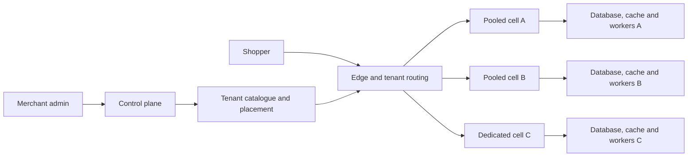

# Scaling and Operating a SaaS Platform

ShopNest serves 1,000 merchants. Most use pooled resources. Some larger or enterprise shops need a separate database, deployment, or region.

## Noisy neighbours

Dhaka Sneakers launches a flash sale. Its slow queries use many database connections and its export jobs fill the worker queue. Rahim's Tea House starts seeing checkout timeouts even though its traffic has not changed. This is a **noisy neighbour** problem.

| Detect | Respond |
| --- | --- |
| Compare latency and errors across tenants and by route. Check database time, connection wait, per-tenant job age, worker use, and queue backlog. | Apply per-tenant request and worker limits. Set query timeouts and bound the number of connections each workload can hold. |
| Find heavy tenants from structured logs, traces, or a sampled top-ten dashboard. | Give checkout and exports separate worker capacity. Use fair queue scheduling so one tenant cannot use every worker slot. |
| Check whether spikes repeat and whether more than one deployment cell is affected. | Spread tenants across cells or move a consistently heavy tenant to dedicated resources. |

Avoid adding a tenant ID label to every high-volume metric without a plan for metric cardinality. Use a small set of aggregate metrics for alerts, and keep tenant-tagged logs or traces for investigation. Use `429` for tenant rate limits and an appropriate retry delay. Preserve capacity for checkout when background work can wait.

## Cost per tenant

Separate direct cost from an allocated share of shared services. Direct cost includes usage such as storage, messages, and dedicated resources. Allocate shared costs using an agreed measure such as request count, database time, or worker time. A tenant that sends cheap reads should not automatically receive the same share as one that runs large exports.

| Monthly example | Amount |
| --- | ---: |
| Direct storage and messaging | ৳300 |
| Allocated shared compute, database, and operations | ৳700 |
| Estimated serving cost | ৳1,000 |
| Subscription revenue | ৳1,500 |
| Revenue less estimated serving cost | ৳500 |

Use the same allocation method when comparing plans or placements. Track changes over time and review outliers. A tenant may need query improvements, tighter limits, a different plan, or a dedicated deployment.

## Control plane, data plane and tenant sharding

The **control plane** manages the tenant lifecycle. It handles onboarding, billing, entitlements, configuration, domain mappings, and where each tenant is deployed. The **data plane** serves storefront traffic, staff APIs, orders, and background jobs.

The catalogue maps the verified hostname to a tenant, and the tenant to a cell and data location. Tenant sharding keeps one merchant's related data together on a shard. A cell can also have separate worker and cache capacity. If Dhaka Sneakers uses a dedicated cell, a spike there is less likely to affect the pooled cells. The actual blast radius depends on which dependencies the cells still share.

Use versioned tenant configuration and cache routing information with an update strategy. Existing shops should be able to serve normal traffic when the billing service is briefly unavailable. Define what happens when a cache entry is stale or the tenant has been disabled. Missing tenant context should stop protected work.

## Moving a tenant

1. Prepare the destination with the right schema version, keys, and capacity. Check residency requirements before copying data.
2. Copy only the tenant's rows and files. Verify counts and important business totals, such as paid orders and invoice amounts.
3. Catch up writes made during the copy using change capture, or use a maintenance window. Pause writes briefly for the final sync. Account for workers and queued jobs.
4. Switch the catalogue entry to the destination and invalidate cached routes. Check that stale routes cannot still accept writes at the old location.
5. Test staff access, checkout, and jobs on the new placement. Keep a recovery window. If the new location has accepted writes, reconcile those changes before routing back.

Migrations are useful when a pooled tenant needs more capacity, a different region, or a dedicated database. Track progress and audit the cutover so support can tell which location owns the live data.

## Enterprise needs

| Need | What to design for |
| --- | --- |
| Dedicated isolation | Identify which parts need separate boundaries. These can include the database, deployment, network, encryption keys, worker capacity, backups, and support access. |
| Data residency | Map where primary data, replicas, backups, logs, and exports are stored or processed. Keep routing and recovery plans within the regions agreed for that tenant. |
| Compliance | Turn specific customer or regulatory requirements into controls, owners, and evidence. Examples include access reviews, audit logs, restore drills, and proof of deletion. Confirm which obligations apply before making commitments. |

A dedicated database strengthens one boundary. Tenant-aware authorisation, safe background jobs, audited support access, and tested backup restores still apply. Validate enterprise controls with evidence from the full request and data lifecycle.
