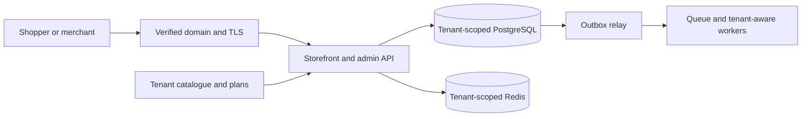

# Research Task — Commerce SaaS for 1,000 Merchants

## Scope and choice

ShopNest needs a hosted storefront, catalogue, checkout, orders, staff offboarding, and subscription billing for 1,000 merchants. A tenant is one merchant account. Merchants can share infrastructure while their data and permissions stay scoped to that account. Start with shared PostgreSQL tables for most merchants. Keep a placement record so a high-traffic merchant or one with dedicated isolation needs can move later.

## Tenant models and leakage risks

| Model | Fit for 1,000 merchants | How data could leak | Main control |
| --- | --- | --- | --- |
| Shared schema | Simple provisioning and one migration per deployment. Per-tenant recovery takes extra work. | A query, join, export, or cache key omits tenant scope. | Require tenant-aware keys and queries, add row-level security where appropriate, and test requests under a restricted role. |
| Schema per tenant | More migration and connection-context work as merchant count grows. Still shares database capacity. | A pooled session retains the last tenant's schema or an export targets the wrong schema. | Resolve the schema from trusted placement, scope it to the transaction, and validate export ownership. |
| Database per tenant | Higher cost and more backups, connections, and migrations. Useful for stronger data isolation or tenant-level restore. | A placement bug selects the wrong database, or an operator shares the wrong backup. | Validate tenant-to-database mappings, scope credentials, and audit restore and export access. |

## Request and checkout flow

Resolve the shop from a verified hostname. For merchant actions, verify the signed-in user's membership and permission. Save the order and its outbox event together. Workers take trusted tenant context from the event and use a stable job ID for duplicate delivery. Cache and file keys include the tenant, even when a tenant uses its own database. The catalogue stores placement, plan, and domain state.

## Failure case and checks

If monthly reports use only the month as a cache key, two shops can get the same report. Include tenant ID and any relevant permission scope in the key. Test two tenants requesting the same period, a worker receiving a mismatched job, and staff trying to export another tenant's order. Use per-tenant queue and error signals to distinguish one noisy shop from a wider outage.

Before choosing capacity, measure peak checkout load, the largest catalogue, and acceptable recovery time for a single tenant. Use a verified export and controlled cutover when moving a tenant to dedicated resources.
