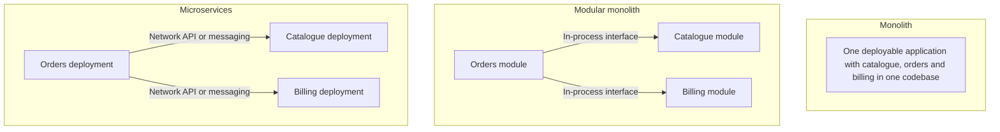

# System Design Foundations

## Clarify the requirements

Start with the people using the system and the actions that matter. For a URL shortener, ask who can create a link, whether links expire, and what happens when a link is deleted. Decide whether analytics, custom domains, and custom aliases are part of the first version.

Write down functional requirements and measurable constraints. For example, the service must create and redirect links, target a p95 redirect time below 100 ms at the service edge, and keep mappings for at least one year. Ask about peak traffic, geographic coverage, data freshness, recovery, and the acceptable budget. Mark unknown numbers as assumptions so they can be corrected later.

## Make a back-of-the-envelope estimate

Suppose the shortener gets 10 million redirects and 100,000 new links per day.

| Estimate | Calculation | Result |
| --- | --- | --- |
| Average redirect requests per second | 10,000,000 / 86,400 | About 116 per second |
| Peak redirect requests per second | Average × assumed 10× peak | About 1,160 per second |
| New mappings in one year | 100,000 × 365 | 36.5 million |
| Raw mapping storage at 500 bytes per row | 36.5 million × 500 bytes | About 18.3 GB |
| Peak database redirects at a 95% cache hit rate | 1,160 × 0.05 | About 58 reads per second |

The storage figure excludes indexes, replicas, and backups. The cache figure assumes the hit rate still holds at peak. Test cold-cache load and uneven traffic. An estimate helps identify what needs testing before choosing server sizes or databases.

Draw the main request path, then work through a failure. What happens if the cache is cold, the database is slow, or a queue stops draining? Check the design against the agreed requirements before adding more components.

## Vertical and horizontal scaling

**Vertical scaling** gives one machine more CPU, memory, or faster storage. It can relieve a database bottleneck without changing the application. It has hardware limits and upgrades can require downtime.

**Horizontal scaling** adds more instances. A load balancer can spread API requests across them. A **stateless service** can handle a request on any healthy instance because it stores shared state in a database, a shared session store, or a suitable token. It can still use local memory for temporary work. Adding API instances will not help much if every request waits for the same overloaded database.

## Building blocks

| Component | What it does | Example and trade-off |
| --- | --- | --- |
| Load balancer | Routes traffic to healthy instances. | Stops sending requests to an unready API instance and lets existing connections drain before a deploy. |
| Cache | Reuses the result of expensive or frequent reads. | Redis stores popular link mappings. Entries can be stale and the database still needs capacity for misses. |
| CDN | Serves cacheable content closer to users. | Serves public images at the edge. Choose cache keys and expiry carefully for content that changes. |
| Database | Stores durable records and supports queries and updates. | A relational database enforces unique short codes and stores their destinations. |
| Queue | Buffers work for workers to run later. | Redirect analytics can be processed in batches. Track queue age and plan for duplicate delivery. |
| Object storage | Stores files or blobs by key. | Keep images and exports there and store the object key and metadata in the database. |

## Choose an architecture style

| Style | Deployment | Good fit | Main cost |
| --- | --- | --- | --- |
| Monolith | One application deploys as a unit. | A small team building one product with frequent shared changes. | Unchecked dependencies can make changes touch many parts of the code. |
| Modular monolith | One deployment with clear internal module interfaces and ownership. | Orders, catalogue, and billing can evolve separately in code while sharing a release. | Boundaries need enforcement. Scaling or deploying one module independently can take extra work. |
| Microservices | Services deploy separately and talk over a network. | Different teams or workloads need independent deployment, scaling, or failure boundaries. | Remote calls, data ownership, observability, and partial failure add operational work. |

A useful service boundary follows a business capability and defines what that capability owns. For example, the order module owns order status. Extract a service when there is a clear need for independent operation and a stable interface, such as notification workers that must scale separately from checkout.

The boxes show deployment boundaries for the same catalogue, orders and billing capabilities.

The modular monolith box is one deployment containing all three modules. Each deployment inside the microservices box can release separately.

## Caching strategies

- **Cache-aside** — Read from the cache first. On a miss, read the database and cache the result. On a write, commit to the database and invalidate the cached entry. A concurrent reader can still repopulate stale data, so use TTLs and version checks when freshness matters.
- **Write-through** — The write path updates the durable store and the cache before reporting a successful write under its chosen contract. This can keep hot reads warm. Define how the cache is repaired if one update fails, and prevent older writes from overwriting newer cached values.
- **Eviction** — The cache removes entries under capacity pressure, for example using a least-recently-used policy. A TTL expires an entry after a set time, even if capacity is available.
- **Invalidation** — An application or cache operator removes an entry because the underlying value changed. A public image can use a versioned URL. A deleted short link may need both application-cache invalidation and a CDN purge if redirects are cached at the edge.

Prevent a burst of simultaneous misses from overloading the database by sharing one cache refill for a hot key. Randomise expiry slightly when many keys might otherwise expire together. Measure hit rate, latency, and errors on the miss path as well.
