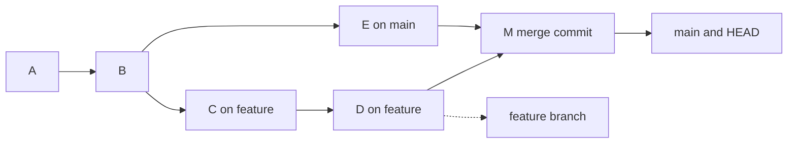
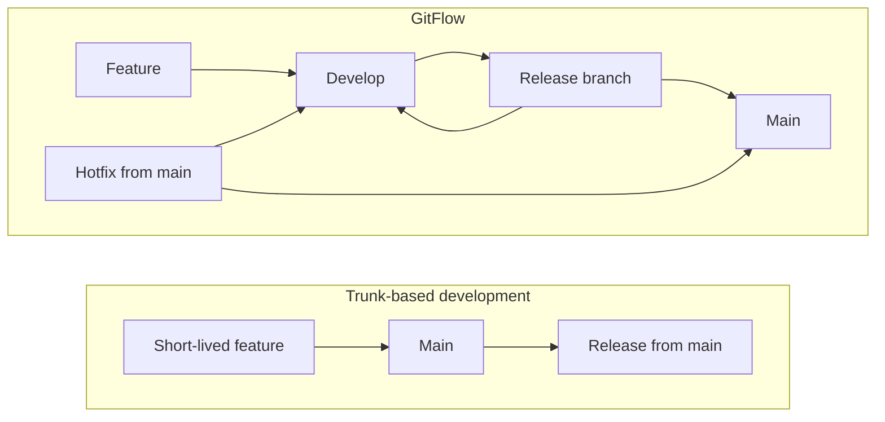
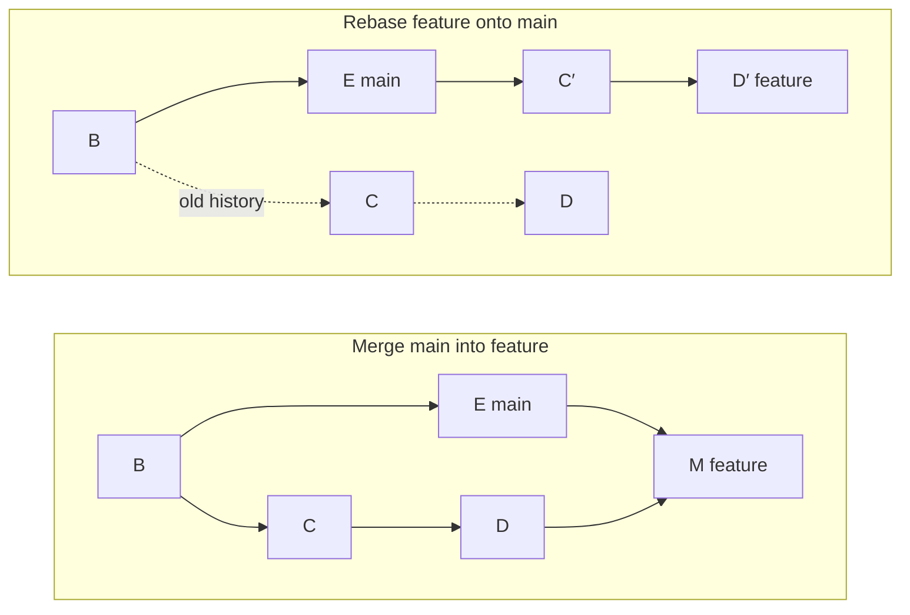
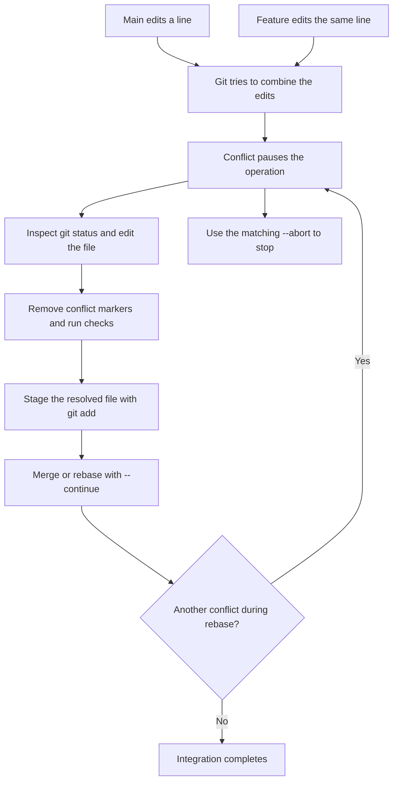
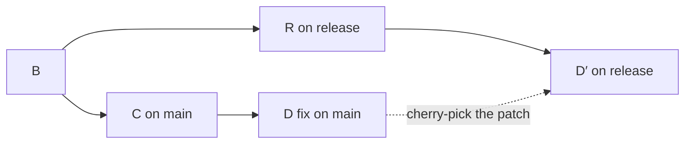
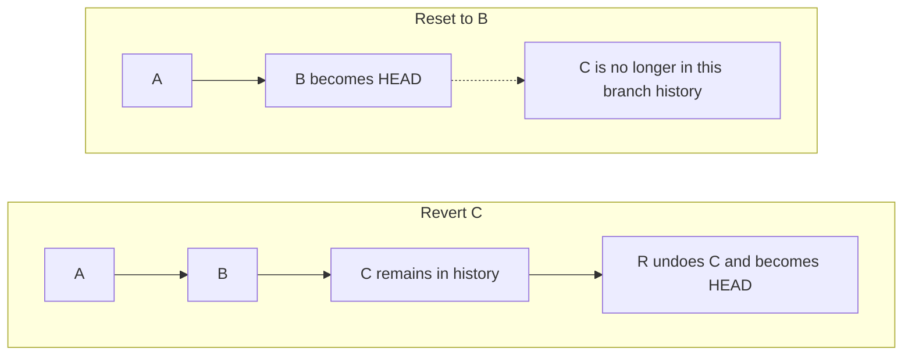
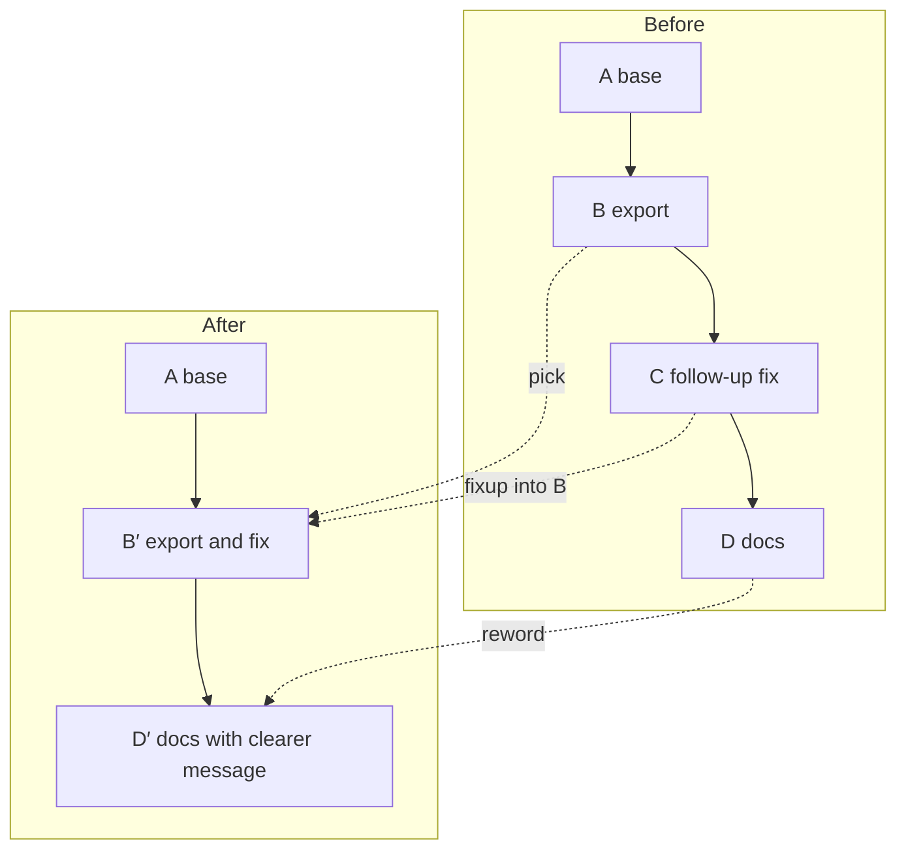

# Git Workflow and History

## A basic branch and pull request

`clone` copies a repository and sets up its remote. A branch names a line of work. A commit records staged changes locally. A push sends commits to a remote branch. A pull fetches changes and integrates them into the checked-out branch.

```bash
git clone https://github.com/ORG/REPO.git
cd REPO
git switch main
git pull --ff-only
git switch -c feat/order-export

# Make the change, then inspect and stage it.
git status
git diff
git add path/to/changed-file
git diff --staged
git commit -m "feat(reports): add order export"
git push -u origin feat/order-export
```

Replace the example URL and path with real values. Open a pull request on the hosting platform from the feature branch into `main`. Link the work item and explain the changes and checks. Reviewers and CI can inspect it before merging. After the PR is merged, switch to `main` and run `git pull --ff-only` to update the local copy. A pull request is a hosting workflow built around Git branches and commits.

### How a feature branch starts and merges

At first both branches point to B. The feature branch adds C and D while main adds E. Git combines the two lines of work at M. The diagram shows a merge commit with two parents. If main had stayed at B, Git could have moved main straight to D with a fast-forward merge.



## Branching strategies

| Strategy | How work flows | Trade-off |
| --- | --- | --- |
| Trunk-based development | Integrate into a shared trunk frequently, directly under team policy or through short-lived branches. Use flags for unfinished work when needed. | Gives early feedback and needs reliable CI and small changes. |
| GitFlow | Keep a long-lived development branch beside main. Use feature, release, and hotfix branches with defined merge routes. | Helps coordinate release windows and adds extra branches, merges, and time before changes meet. |

A team releasing every day may prefer short-lived branches. A team maintaining older releases can also use trunk-based development with separate maintenance branches. Choose based on release needs and how quickly changes can be checked together.

### Where work joins the release



## Merge, rebase and selective changes

Suppose `main` moved while the order export branch was open. Fetch the latest remote reference and choose one integration method according to team policy.

```bash
git fetch origin
# With the feature branch checked out, choose one.
git merge origin/main
# Or replay the feature commits on the new base.
git rebase origin/main
```

A **merge** combines histories and can create a commit with two parents. If the branch can simply move forward, Git can fast-forward without creating a merge commit. A **rebase** replays commits on a new base, normally giving those commits new IDs. Use it on work whose history is safe to rewrite. Coordinate before changing a branch other people use.

For conflicts, edit the affected files, stage the resolution, then use `git merge --continue` or `git rebase --continue` as appropriate. Use the corresponding `--abort` if the integration should be abandoned. If the team's workflow requires replacing a previously pushed personal branch after rebase, fetch and verify the remote state before using `git push --force-with-lease`. Protected shared branches should follow their merge policy.

| Command | What it does | Example use |
| --- | --- | --- |
| `git cherry-pick <commit>` | Applies a selected commit as a new commit on the current branch. | Bring one bug fix to a maintenance branch. Check whether it depends on earlier changes. |
| `git revert <commit>` | Adds a commit that reverses a previous commit's changes. | Undo a faulty change on shared main while preserving history. |
| `git reset --soft HEAD~1` | Moves the branch back and leaves the old change staged. | Redo a recent local commit. |
| `git reset --mixed HEAD~1` | Moves the branch back and unstages changes while keeping working files. | Regroup a local commit. |
| `git reset --hard HEAD~1` | Moves the branch and replaces tracked working files and the index. | Use only when the discarded local work is understood and disposable. |

### Merge vs rebase from the same starting point

Both examples start after main and feature diverge at B. E is the newest main commit. C and D are feature commits.

| Operation on the feature branch | Where main points | Where feature points |
| --- | --- | --- |
| Merge main into feature | E | M, a new commit with D and E as parents |
| Rebase feature onto main | E | D′, after replaying C and D on top of E |



These examples integrate main into the feature branch locally. A later PR can merge the feature into main according to the repository's merge rules.

### What happens when there is a conflict

For example, main changes an export limit from 100 to 200 while the feature changes the same line from 100 to 500. Git cannot infer the intended limit. Read both changes and agree on the correct behaviour before editing the file.



During a rebase, conflicts can appear again on a later commit because Git replays commits one at a time.

### Cherry-pick one fix

Release branches independently from B. The fix in D can also be applied to release. D′ records that patch on the release branch and has its own parent and commit ID.



### Revert vs reset

Both examples start with C as the latest commit. Revert adds R to undo C's changes. Reset moves the current branch pointer to B. The reset mode decides what happens to staged changes and working files.



## Interactive rebase

On a private branch with at least three commits after its base, `git rebase -i HEAD~3` opens a list of the last three commits. Keep a commit with `pick`, change its message with `reword`, or combine it with the previous entry using `squash` or `fixup`. Run tests after editing history. Use `git rebase --abort` if the operation is still in progress and needs to stop.

### Interactive rebase before and after

In this example, keep the export implementation, fold its follow-up fix into it, and rewrite the documentation commit message. The new commits get new IDs. A remains the base.



## Commit quality

An **atomic commit** contains one coherent change and leaves the code in a usable state. Keep an unrelated formatting change out of the export commit. Use a short subject that describes the outcome.

Conventional Commits uses a type, an optional scope, and a description. Examples are `feat(reports): add order export`, `fix(reports): include orders on the end date`, and `docs(reports): describe export limits`. A breaking change can use an exclamation mark after the type or scope or a `BREAKING CHANGE:` footer. Version automation depends on the rules the team configures. [Conventional Commits specification](https://www.conventionalcommits.org/en/v1.0.0/)
